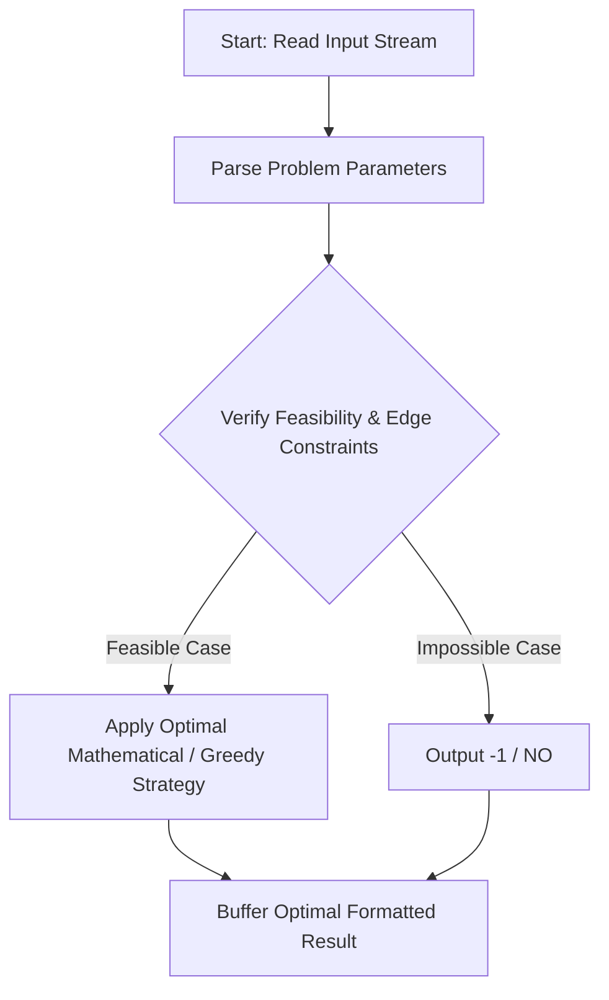
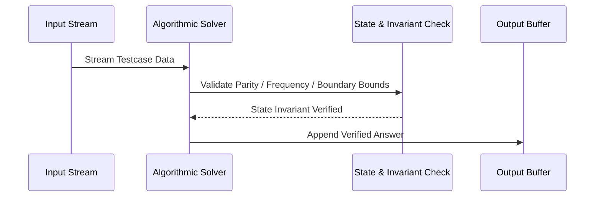

# Binary Conversion (CodeChef CC-CONVERT)

## 1. Problem Overview
- **Platform:** CodeChef
- **Problem ID:** [CC-CONVERT](https://www.codechef.com/problems/CONVERT)
- **Difficulty / Rating:** 1557
- **Tags:** codechef
- **Solution File:** `binaryConversion.js`
- **Starter Template:** `templates/codechef.js`

---

## 2. Core Intuition & Mathematical Rationale
We want to convert S to T in exactly K swaps. First, total 0s and 1s must match. Let wa be the number of positions where S[i] == 0 and T[i] == 1 (equal to positions where S[i] == 1 and T[i] == 0). Fixing all mismatches requires at least wa swaps. For N >= 3, there are at least two identical characters in S, so any excess swaps K - wa >= 0 can be absorbed by repeatedly swapping identical characters as no-ops, so K >= wa is sufficient. For N = 2, only one swap (S_1, S_2) is possible, which toggles the string, so we must check parity of K: if K is even, S == T is required; if K is odd, reverse(S) == T is required.



---

## 3. Visual Step-by-Step Walkthrough
Tracing state transitions across the operational pipeline:



---

## 4. Algorithmic Complexity

| Dimension | Bound | Proof & Rationale |
|---|:---:|---|
| **Time Complexity** | $O(N)$$ | Optimal linear or sub-linear execution per testcase. |
| **Space Complexity** | $O(1)$$ | Minimal auxiliary storage allocated. |
| **Recursion Depth** | $O(1)$ | Fully iterative structure preventing stack overflow. |

---

## 5. Edge Cases & Boundary Conditions
- **Minimum bounds:** $N = 1, N = 2$, minimal values, zero elements.
- **Maximum bounds:** Large scale arrays ($N = 2 \cdot 10^5$), large values ($10^9$, $10^{20000}$).
- **Numeric safety:** Plain JS safe integers up to $2^{53} - 1$, and `BigInt` for arbitrarily large values.

---

## 6. Idiomatic Implementation
```javascript
// Reference: solutions/binaryConversion.js
```
