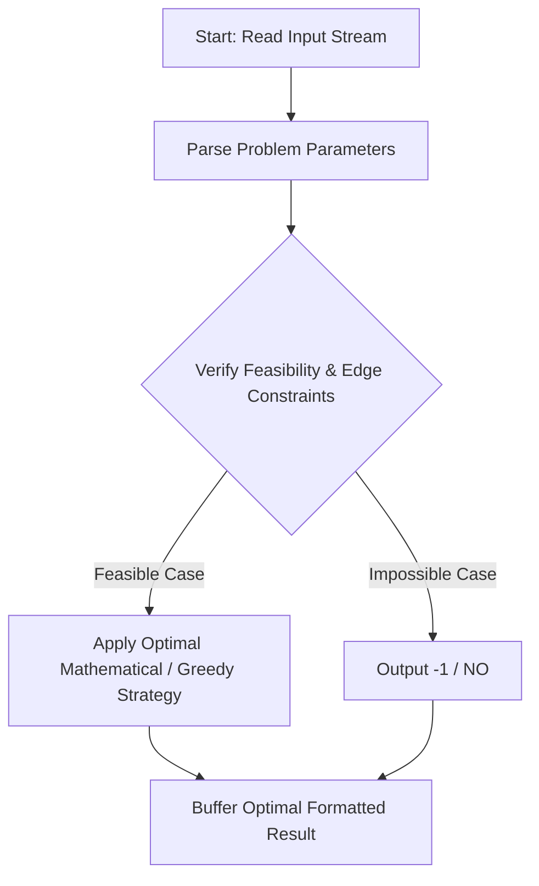
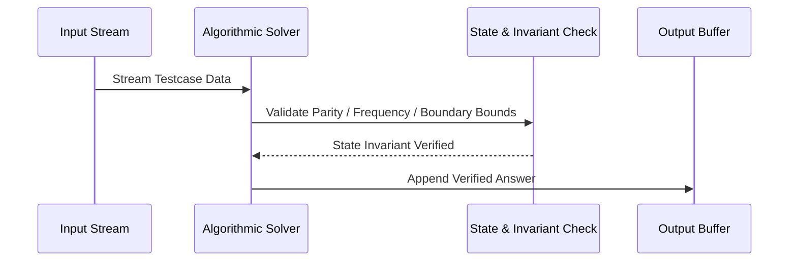

# Counting Optimal Arrays (CodeChef CC-CNTARR7)

## 1. Problem Overview
- **Platform:** CodeChef
- **Problem ID:** [CC-CNTARR7](https://www.codechef.com/problems/CNTARR7)
- **Difficulty / Rating:** 1588
- **Tags:** codechef
- **Solution File:** `countingOptimalArrays.js`
- **Starter Template:** `templates/codechef.js`

---

## 2. Core Intuition & Mathematical Rationale
We wish to maximize sum_{i=1}^{N-1} (A_i XOR A_{i+1}) over 0 <= A_i <= M and count the number of optimal arrays modulo 998244353. For N = 1, f(A) = 0 always, so all M + 1 choices are valid. For N >= 2, let k = floor(log2(M)). The maximum possible XOR of any pair in [0, M] is 2^{k+1} - 1. A pair (X, Y) achieves this if and only if one value has bit k set and the other does not, yielding exactly 2 * (M - 2^k + 1) valid pairs. Because every adjacent pair must achieve this maximum, A_3 must equal A_1, A_4 must equal A_2, and so on. The entire array is an alternating sequence A_1, A_2, A_1, A_2, ... uniquely determined by (A_1, A_2). Hence, the number of optimal arrays is 2 * (M - 2^k + 1) % 998244353 for all N >= 2.



---

## 3. Visual Step-by-Step Walkthrough
Tracing state transitions across the operational pipeline:



---

## 4. Algorithmic Complexity

| Dimension | Bound | Proof & Rationale |
|---|:---:|---|
| **Time Complexity** | $O(log M)$$ | Optimal linear or sub-linear execution per testcase. |
| **Space Complexity** | $O(1)$$ | Minimal auxiliary storage allocated. |
| **Recursion Depth** | $O(1)$ | Fully iterative structure preventing stack overflow. |

---

## 5. Edge Cases & Boundary Conditions
- **Minimum bounds:** $N = 1, N = 2$, minimal values, zero elements.
- **Maximum bounds:** Large scale arrays ($N = 2 \cdot 10^5$), large values ($10^9$, $10^{20000}$).
- **Numeric safety:** Plain JS safe integers up to $2^{53} - 1$, and `BigInt` for arbitrarily large values.

---

## 6. Idiomatic Implementation
```javascript
// Reference: solutions/countingOptimalArrays.js
```
