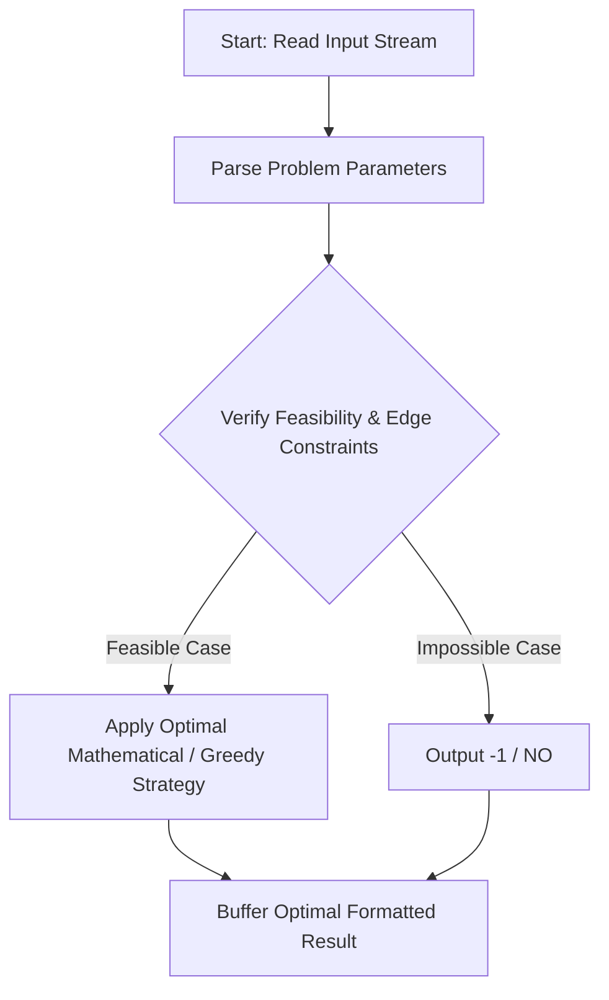
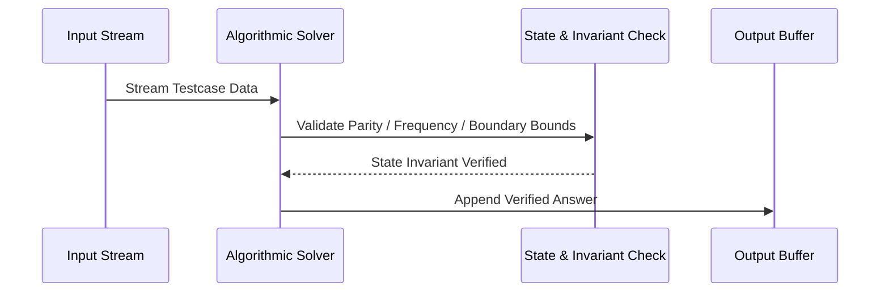

# Equal by XORing (CodeChef CC-EQBYXOR)

## 1. Problem Overview
- **Platform:** CodeChef
- **Problem ID:** [CC-EQBYXOR](https://www.codechef.com/problems/EQBYXOR)
- **Difficulty / Rating:** 1507
- **Tags:** codechef
- **Solution File:** `equalByXORing.js`
- **Starter Template:** `templates/codechef.js`

---

## 2. Core Intuition & Mathematical Rationale
We want to transform A into B using operations A := A XOR X with 1 <= X < N. Let D = A XOR B. If A == B, D = 0, taking 0 operations. If D < N, we can choose X = D in 1 operation. If D >= N, let k = floor(log2(D)). To achieve D in 2 operations, at least one chosen X must have its k-th bit set, requiring N > 2^k. If 2^k < N, we can choose X_1 = 2^k < N and X_2 = D - 2^k < 2^k < N, so 2 operations always suffice. If 2^k >= N, no elements < N have bit k set, so bit k can never be produced by any number of operations, making it impossible (-1).



---

## 3. Visual Step-by-Step Walkthrough
Tracing state transitions across the operational pipeline:



---

## 4. Algorithmic Complexity

| Dimension | Bound | Proof & Rationale |
|---|:---:|---|
| **Time Complexity** | $O(1)$$ | Optimal linear or sub-linear execution per testcase. |
| **Space Complexity** | $O(1)$$ | Minimal auxiliary storage allocated. |
| **Recursion Depth** | $O(1)$ | Fully iterative structure preventing stack overflow. |

---

## 5. Edge Cases & Boundary Conditions
- **Minimum bounds:** $N = 1, N = 2$, minimal values, zero elements.
- **Maximum bounds:** Large scale arrays ($N = 2 \cdot 10^5$), large values ($10^9$, $10^{20000}$).
- **Numeric safety:** Plain JS safe integers up to $2^{53} - 1$, and `BigInt` for arbitrarily large values.

---

## 6. Idiomatic Implementation
```javascript
// Reference: solutions/equalByXORing.js
```
