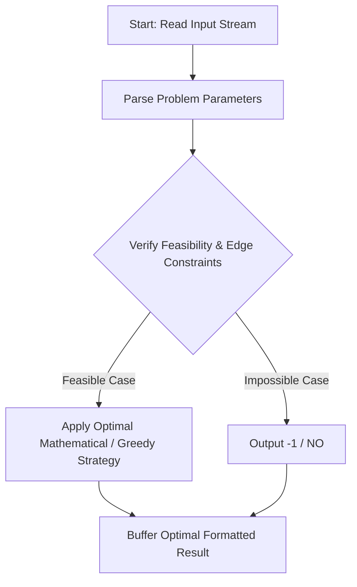
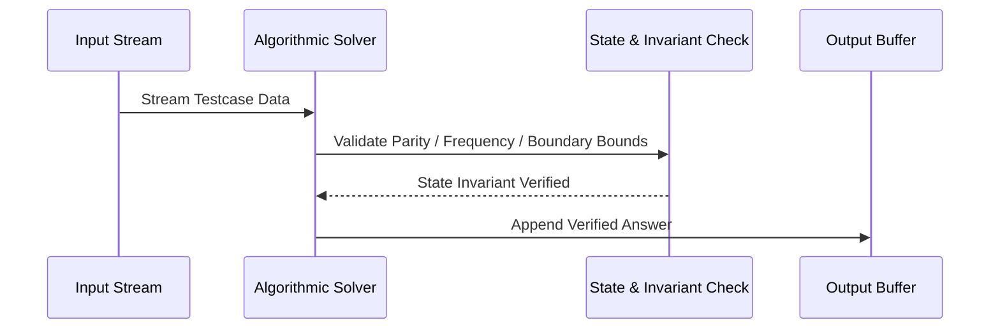

# Equal MEX (CodeChef CC-EQUALMEX)

## 1. Problem Overview
- **Platform:** CodeChef
- **Problem ID:** [CC-EQUALMEX](https://www.codechef.com/problems/EQUALMEX)
- **Difficulty / Rating:** 1598
- **Tags:** codechef
- **Solution File:** `equalMEX.js`
- **Starter Template:** `templates/codechef.js`

---

## 2. Core Intuition & Mathematical Rationale
We are given an array of 2N integers with elements in [0, N]. We want to partition into two multisets A and B of size N each such that MEX(A) = MEX(B) = M.
For MEX to equal M, every integer x in [0, M - 1] must appear at least once in both A and B, which requires freq[x] >= 2 in the original array. Furthermore, M must not appear in A and must not appear in B, which requires freq[M] = 0 in the original array. If any integer x < M has freq[x] == 1, it can only go to one set, capping that set MEX at x while the other set has MEX > x, making equal MEX impossible. Therefore, the condition for YES is: scanning x = 0, 1, 2, ..., if the first non-satisfying frequency has freq[x] == 0, we can achieve MEX = x and answer is YES; if freq[x] == 1, no equal MEX is possible and answer is NO.



---

## 3. Visual Step-by-Step Walkthrough
Tracing state transitions across the operational pipeline:



---

## 4. Algorithmic Complexity

| Dimension | Bound | Proof & Rationale |
|---|:---:|---|
| **Time Complexity** | $O(N)$$ | Optimal linear or sub-linear execution per testcase. |
| **Space Complexity** | $O(N)$$ | Minimal auxiliary storage allocated. |
| **Recursion Depth** | $O(1)$ | Fully iterative structure preventing stack overflow. |

---

## 5. Edge Cases & Boundary Conditions
- **Minimum bounds:** $N = 1, N = 2$, minimal values, zero elements.
- **Maximum bounds:** Large scale arrays ($N = 2 \cdot 10^5$), large values ($10^9$, $10^{20000}$).
- **Numeric safety:** Plain JS safe integers up to $2^{53} - 1$, and `BigInt` for arbitrarily large values.

---

## 6. Idiomatic Implementation
```javascript
// Reference: solutions/equalMEX.js
```
