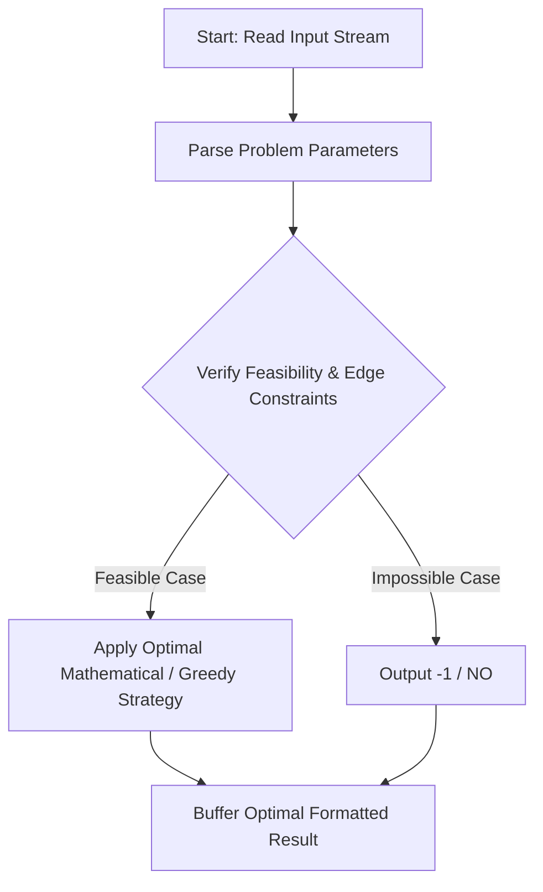
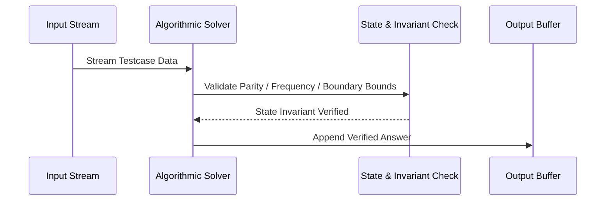

# Good Binary Strings (CodeChef CC-GOODBINSTR)

## 1. Problem Overview
- **Platform:** CodeChef
- **Problem ID:** [CC-GOODBINSTR](https://www.codechef.com/problems/GOODBINSTR)
- **Difficulty / Rating:** 1573
- **Tags:** codechef
- **Solution File:** `goodBinaryStrings.js`
- **Starter Template:** `templates/codechef.js`

---

## 2. Core Intuition & Mathematical Rationale
A binary string is good if the number of occurrences of 01 equals the number of occurrences of 10. By telescoping parity arguments, count(01) == count(10) if and only if S_1 == S_N (the first character equals the last character). If S_1 != S_N initially, flipping either S_1 or S_N makes the endpoints equal, while flipping any internal character leaves the endpoints unequal; hence exactly 2 indices work. If S_1 == S_N initially, flipping either endpoint breaks equality, while flipping any of the N - 2 internal characters preserves equality; hence N - 2 indices work.



---

## 3. Visual Step-by-Step Walkthrough
Tracing state transitions across the operational pipeline:



---

## 4. Algorithmic Complexity

| Dimension | Bound | Proof & Rationale |
|---|:---:|---|
| **Time Complexity** | $O(1)$$ | Optimal linear or sub-linear execution per testcase. |
| **Space Complexity** | $O(1)$$ | Minimal auxiliary storage allocated. |
| **Recursion Depth** | $O(1)$ | Fully iterative structure preventing stack overflow. |

---

## 5. Edge Cases & Boundary Conditions
- **Minimum bounds:** $N = 1, N = 2$, minimal values, zero elements.
- **Maximum bounds:** Large scale arrays ($N = 2 \cdot 10^5$), large values ($10^9$, $10^{20000}$).
- **Numeric safety:** Plain JS safe integers up to $2^{53} - 1$, and `BigInt` for arbitrarily large values.

---

## 6. Idiomatic Implementation
```javascript
// Reference: solutions/goodBinaryStrings.js
```
