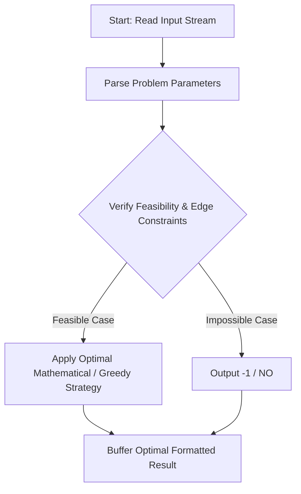
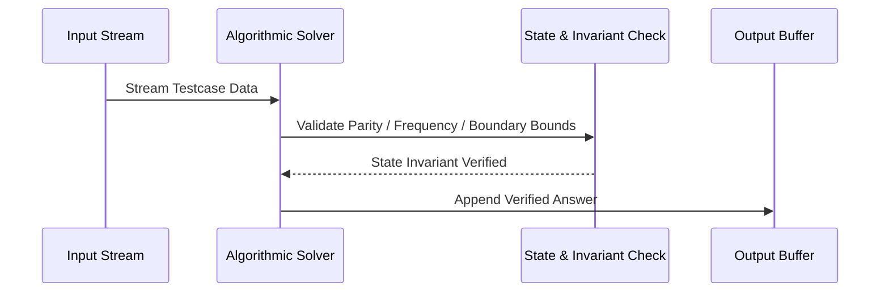

# Greedy LIS Algorithm (CodeChef CC-GREEDYLIS)

## 1. Problem Overview
- **Platform:** CodeChef
- **Problem ID:** [CC-GREEDYLIS](https://www.codechef.com/problems/GREEDYLIS)
- **Difficulty / Rating:** 1559
- **Tags:** codechef
- **Solution File:** `greedyLISAlgorithm.js`
- **Starter Template:** `templates/codechef.js`

---

## 2. Core Intuition & Mathematical Rationale
We want to construct a permutation of length N where actual LIS - alicelis == X. Alice greedy LIS takes the first element and any subsequent element greater than the last chosen. For N = 1, X = 0 gives [1], while X > 0 is impossible (-1). For N >= 2, X = N and X = N - 1 are impossible (-1). For X in [0, N - 2], setting P_1 = X + 2 followed by 1, 2, ..., N (omitting X + 2) yields a permutation where greedy LIS has length N - (X + 2) + 1 = N - X - 1, and true LIS (ignoring P_1) has length N - 1, giving exact difference (N - 1) - (N - X - 1) = X.



---

## 3. Visual Step-by-Step Walkthrough
Tracing state transitions across the operational pipeline:



---

## 4. Algorithmic Complexity

| Dimension | Bound | Proof & Rationale |
|---|:---:|---|
| **Time Complexity** | $O(N)$$ | Optimal linear or sub-linear execution per testcase. |
| **Space Complexity** | $O(N)$$ | Minimal auxiliary storage allocated. |
| **Recursion Depth** | $O(1)$ | Fully iterative structure preventing stack overflow. |

---

## 5. Edge Cases & Boundary Conditions
- **Minimum bounds:** $N = 1, N = 2$, minimal values, zero elements.
- **Maximum bounds:** Large scale arrays ($N = 2 \cdot 10^5$), large values ($10^9$, $10^{20000}$).
- **Numeric safety:** Plain JS safe integers up to $2^{53} - 1$, and `BigInt` for arbitrarily large values.

---

## 6. Idiomatic Implementation
```javascript
// Reference: solutions/greedyLISAlgorithm.js
```
