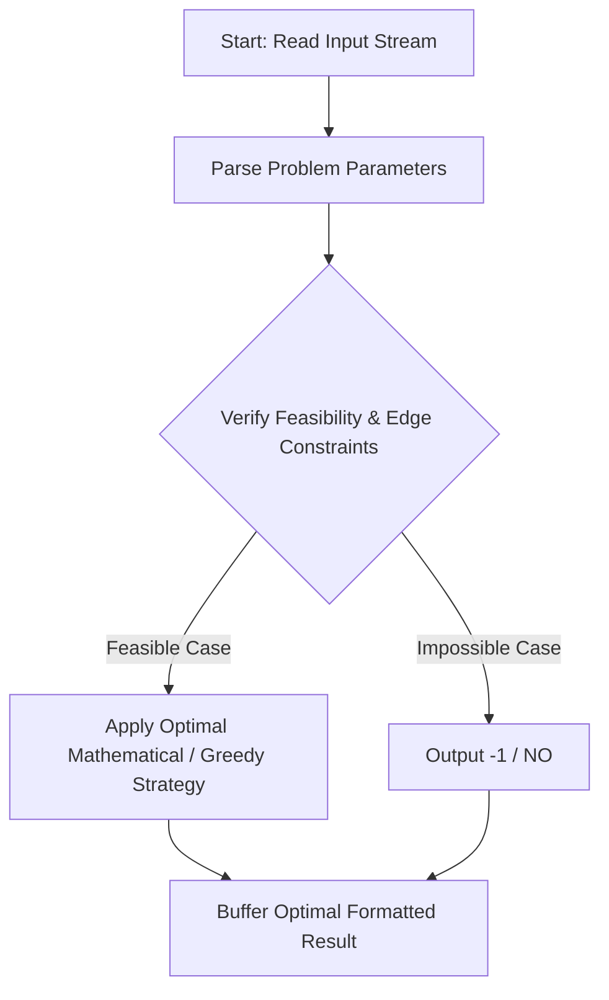
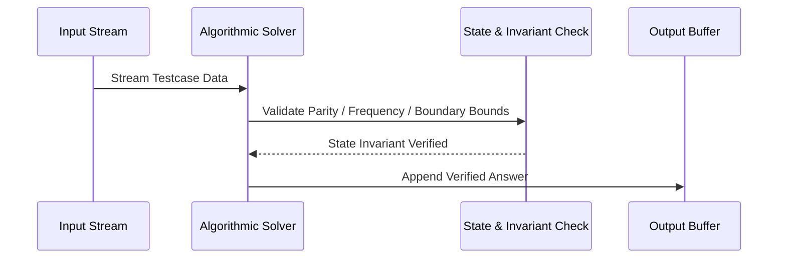

# Largest K (CodeChef CC-LARGESTK)

## 1. Problem Overview
- **Platform:** CodeChef
- **Problem ID:** [CC-LARGESTK](https://www.codechef.com/problems/LARGESTK)
- **Difficulty / Rating:** 1547
- **Tags:** codechef
- **Solution File:** `largestK.js`
- **Starter Template:** `templates/codechef.js`

---

## 2. Core Intuition & Mathematical Rationale
Given an array A of size N, find the largest K such that there is a subsequence of length K where K is divisible by the number of distinct elements D in S. To maximize K for a fixed D, we sort element frequencies descending: c_1 >= c_2 >= ... >= c_U. Choosing the top D distinct elements provides total available occurrences T_D = sum_{i=1}^D c_i. Since we can choose any count k_i in [1, c_i] as long as each element is chosen at least once, any total sum in [D, T_D] is achievable. The largest multiple of D in [D, T_D] is floor(T_D / D) * D. We maximize this quantity over all 1 <= D <= U in O(N log N).



---

## 3. Visual Step-by-Step Walkthrough
Tracing state transitions across the operational pipeline:



---

## 4. Algorithmic Complexity

| Dimension | Bound | Proof & Rationale |
|---|:---:|---|
| **Time Complexity** | $O(N log N)$$ | Optimal linear or sub-linear execution per testcase. |
| **Space Complexity** | $O(N)$$ | Minimal auxiliary storage allocated. |
| **Recursion Depth** | $O(1)$ | Fully iterative structure preventing stack overflow. |

---

## 5. Edge Cases & Boundary Conditions
- **Minimum bounds:** $N = 1, N = 2$, minimal values, zero elements.
- **Maximum bounds:** Large scale arrays ($N = 2 \cdot 10^5$), large values ($10^9$, $10^{20000}$).
- **Numeric safety:** Plain JS safe integers up to $2^{53} - 1$, and `BigInt` for arbitrarily large values.

---

## 6. Idiomatic Implementation
```javascript
// Reference: solutions/largestK.js
```
