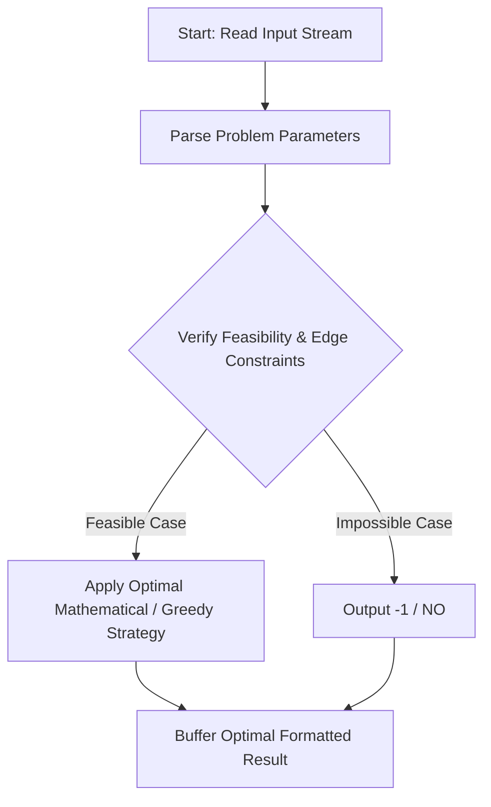
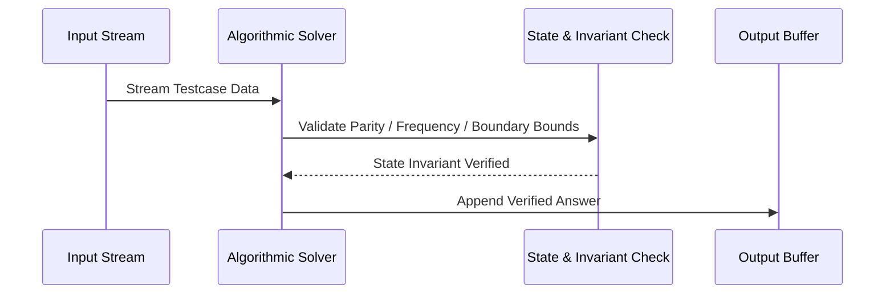

# Nice Array (CodeChef CC-NICEARRAY)

## 1. Problem Overview
- **Platform:** CodeChef
- **Problem ID:** [CC-NICEARRAY](https://www.codechef.com/problems/NICEARRAY)
- **Difficulty / Rating:** 1546
- **Tags:** codechef
- **Solution File:** `niceArray.js`
- **Starter Template:** `templates/codechef.js`

---

## 2. Core Intuition & Mathematical Rationale
For each element A_i, B_i can be chosen as either floor(A_i / K) or ceil(A_i / K). If A_i is divisible by K, B_i is fixed at A_i / K. If A_i is not divisible by K, ceil(A_i / K) = floor(A_i / K) + 1, so we have a flexible choice to add 1 to the sum. Let S_min = sum floor(A_i / K) and let C be the count of elements not divisible by K. The set of achievable sums B_1 + ... + B_N is the contiguous integer range [S_min, S_min + C]. We can achieve sum 0 if and only if S_min <= 0 and S_min + C >= 0.



---

## 3. Visual Step-by-Step Walkthrough
Tracing state transitions across the operational pipeline:



---

## 4. Algorithmic Complexity

| Dimension | Bound | Proof & Rationale |
|---|:---:|---|
| **Time Complexity** | $O(N)$$ | Optimal linear or sub-linear execution per testcase. |
| **Space Complexity** | $O(1)$$ | Minimal auxiliary storage allocated. |
| **Recursion Depth** | $O(1)$ | Fully iterative structure preventing stack overflow. |

---

## 5. Edge Cases & Boundary Conditions
- **Minimum bounds:** $N = 1, N = 2$, minimal values, zero elements.
- **Maximum bounds:** Large scale arrays ($N = 2 \cdot 10^5$), large values ($10^9$, $10^{20000}$).
- **Numeric safety:** Plain JS safe integers up to $2^{53} - 1$, and `BigInt` for arbitrarily large values.

---

## 6. Idiomatic Implementation
```javascript
// Reference: solutions/niceArray.js
```
