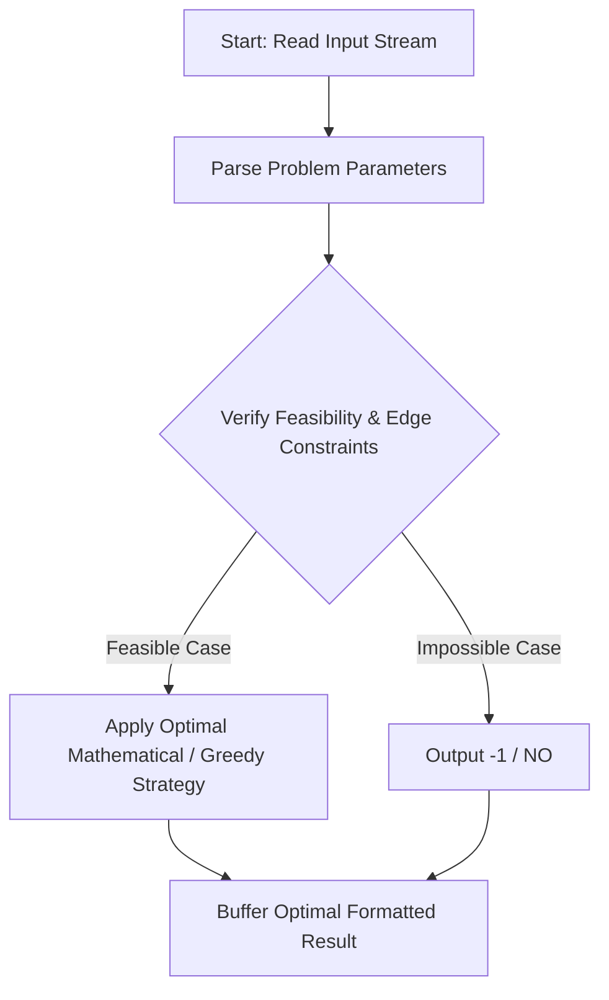
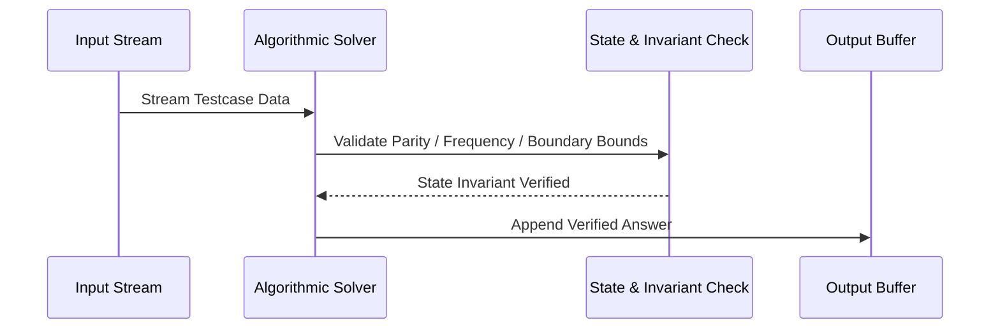

# Non-Primes 101 (CodeChef CC-NONPRIME101)

## 1. Problem Overview
- **Platform:** CodeChef
- **Problem ID:** [CC-NONPRIME101](https://www.codechef.com/problems/NONPRIME101)
- **Difficulty / Rating:** 1516
- **Tags:** codechef
- **Solution File:** `nonPrimes101.js`
- **Starter Template:** `templates/codechef.js`

---

## 2. Core Intuition & Mathematical Rationale
Given array A with 1 <= A_i <= 100, find two distinct indices (i, j) such that A_i + A_j is composite (not prime), or report -1. Since elements are in [1, 100], sums are in [2, 200]. We sieve primes up to 200 in O(1). For each distinct value present in A, we record up to two occurrence indices. We then check all pairs of distinct values (v1, v2) and identical values (v1, v1) that occur at least twice. Since there are at most 100 distinct values, checking all pairs takes at most 5000 checks per testcase. Any composite sum found yields the answer immediately; otherwise -1.



---

## 3. Visual Step-by-Step Walkthrough
Tracing state transitions across the operational pipeline:



---

## 4. Algorithmic Complexity

| Dimension | Bound | Proof & Rationale |
|---|:---:|---|
| **Time Complexity** | $O(N + V^2) where V <= 100$$ | Optimal linear or sub-linear execution per testcase. |
| **Space Complexity** | $O(V)$$ | Minimal auxiliary storage allocated. |
| **Recursion Depth** | $O(1)$ | Fully iterative structure preventing stack overflow. |

---

## 5. Edge Cases & Boundary Conditions
- **Minimum bounds:** $N = 1, N = 2$, minimal values, zero elements.
- **Maximum bounds:** Large scale arrays ($N = 2 \cdot 10^5$), large values ($10^9$, $10^{20000}$).
- **Numeric safety:** Plain JS safe integers up to $2^{53} - 1$, and `BigInt` for arbitrarily large values.

---

## 6. Idiomatic Implementation
```javascript
// Reference: solutions/nonPrimes101.js
```
