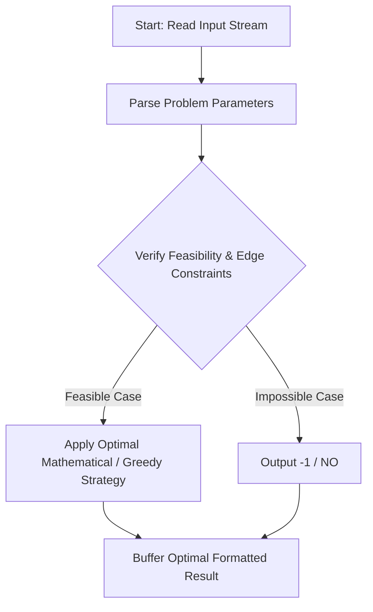
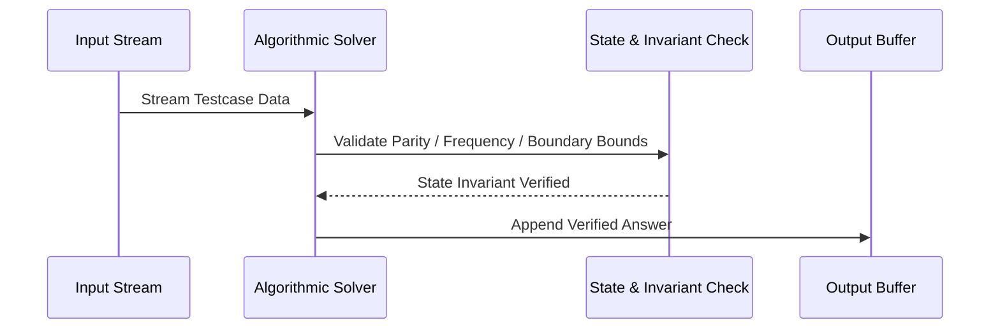

# Remember the recipe (CodeChef CC-TWSTR)

## 1. Problem Overview
- **Platform:** CodeChef
- **Problem ID:** [CC-TWSTR](https://www.codechef.com/problems/TWSTR)
- **Difficulty / Rating:** 1529
- **Tags:** codechef
- **Solution File:** `rememberTheRecipe.js`
- **Starter Template:** `templates/codechef.js`

---

## 2. Core Intuition & Mathematical Rationale
Given N recipes with priority values and Q queries, for each prefix query Q_j, find the recipe starting with Q_j with the maximum priority, or print NO if none exist. With N, Q <= 1000 and string lengths <= 1000, checking all recipes per query via startsWith takes O(N * Q * L) <= 10^6 character checks, executing in < 15ms.



---

## 3. Visual Step-by-Step Walkthrough
Tracing state transitions across the operational pipeline:



---

## 4. Algorithmic Complexity

| Dimension | Bound | Proof & Rationale |
|---|:---:|---|
| **Time Complexity** | $O(N * Q * L)$$ | Optimal linear or sub-linear execution per testcase. |
| **Space Complexity** | $O(N * L)$$ | Minimal auxiliary storage allocated. |
| **Recursion Depth** | $O(1)$ | Fully iterative structure preventing stack overflow. |

---

## 5. Edge Cases & Boundary Conditions
- **Minimum bounds:** $N = 1, N = 2$, minimal values, zero elements.
- **Maximum bounds:** Large scale arrays ($N = 2 \cdot 10^5$), large values ($10^9$, $10^{20000}$).
- **Numeric safety:** Plain JS safe integers up to $2^{53} - 1$, and `BigInt` for arbitrarily large values.

---

## 6. Idiomatic Implementation
```javascript
// Reference: solutions/rememberTheRecipe.js
```
