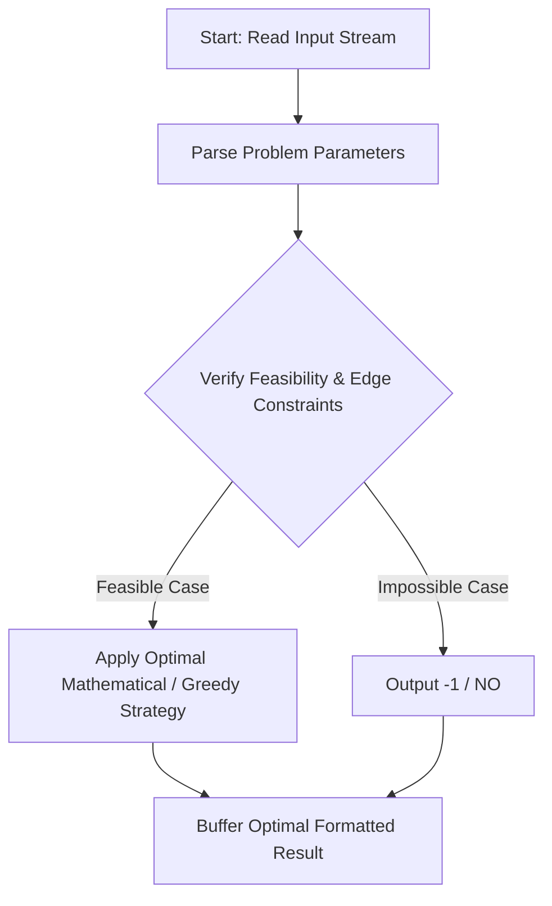
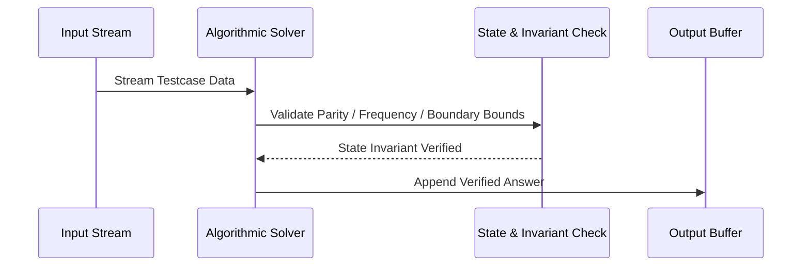

# Sereja and ASum (CodeChef CC-LFEB14B)

## 1. Problem Overview
- **Platform:** CodeChef
- **Problem ID:** [CC-LFEB14B](https://www.codechef.com/problems/LFEB14B)
- **Difficulty / Rating:** 1559
- **Tags:** codechef
- **Solution File:** `serejaAndASum.js`
- **Starter Template:** `templates/codechef.js`

---

## 2. Core Intuition & Mathematical Rationale
We want to delete elements from array a such that the arithmetic mean of remaining elements is maximized. The maximum possible arithmetic mean of any subset is M = max(a). Any subset containing an element strictly less than M will have mean strictly less than M. Thus, to achieve mean M, every retained element must equal M. If M appears cnt times in the array, any non-empty subset of these cnt occurrences has mean M. There are 2^{cnt} - 1 such non-empty subsets, which we compute modulo 10^9 + 7 via binary exponentiation.



---

## 3. Visual Step-by-Step Walkthrough
Tracing state transitions across the operational pipeline:



---

## 4. Algorithmic Complexity

| Dimension | Bound | Proof & Rationale |
|---|:---:|---|
| **Time Complexity** | $O(N + log cnt)$$ | Optimal linear or sub-linear execution per testcase. |
| **Space Complexity** | $O(1)$$ | Minimal auxiliary storage allocated. |
| **Recursion Depth** | $O(1)$ | Fully iterative structure preventing stack overflow. |

---

## 5. Edge Cases & Boundary Conditions
- **Minimum bounds:** $N = 1, N = 2$, minimal values, zero elements.
- **Maximum bounds:** Large scale arrays ($N = 2 \cdot 10^5$), large values ($10^9$, $10^{20000}$).
- **Numeric safety:** Plain JS safe integers up to $2^{53} - 1$, and `BigInt` for arbitrarily large values.

---

## 6. Idiomatic Implementation
```javascript
// Reference: solutions/serejaAndASum.js
```
