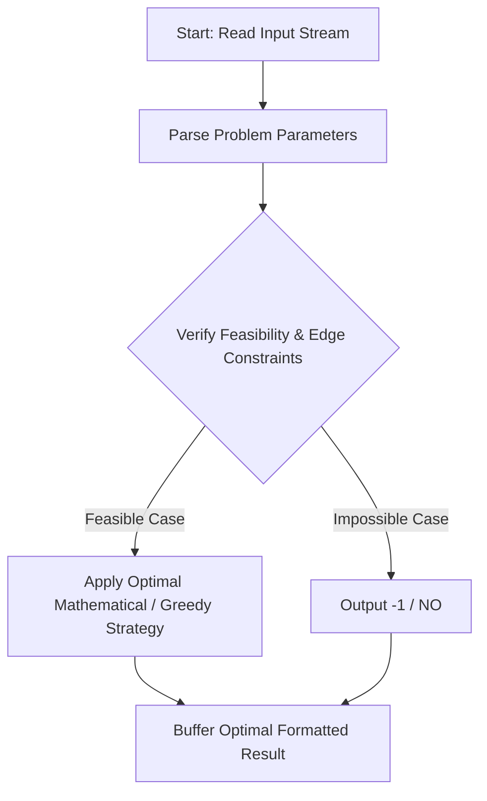
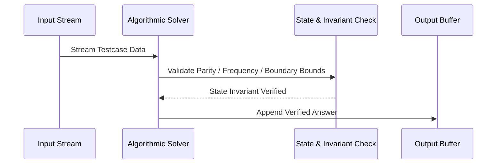

# Sum of numbers (CodeChef CC-NUMSUM)

## 1. Problem Overview
- **Platform:** CodeChef
- **Problem ID:** [CC-NUMSUM](https://www.codechef.com/problems/NUMSUM)
- **Difficulty / Rating:** 1510
- **Tags:** codechef
- **Solution File:** `sumOfNumbers.js`
- **Starter Template:** `templates/codechef.js`

---

## 2. Core Intuition & Mathematical Rationale
Given a large integer n with up to 20000 digits, compute the sum of the first n natural numbers 1 + 2 + ... + n = n * (n + 1) / 2. Native BigInt in Node.js handles arbitrary-precision integers efficiently with Karatsuba multiplication, computing the 40000-digit product and division by 2 in ~3ms per testcase.



---

## 3. Visual Step-by-Step Walkthrough
Tracing state transitions across the operational pipeline:



---

## 4. Algorithmic Complexity

| Dimension | Bound | Proof & Rationale |
|---|:---:|---|
| **Time Complexity** | $O(D^{1.58}) where D <= 20000 digits$$ | Optimal linear or sub-linear execution per testcase. |
| **Space Complexity** | $O(D)$$ | Minimal auxiliary storage allocated. |
| **Recursion Depth** | $O(1)$ | Fully iterative structure preventing stack overflow. |

---

## 5. Edge Cases & Boundary Conditions
- **Minimum bounds:** $N = 1, N = 2$, minimal values, zero elements.
- **Maximum bounds:** Large scale arrays ($N = 2 \cdot 10^5$), large values ($10^9$, $10^{20000}$).
- **Numeric safety:** Plain JS safe integers up to $2^{53} - 1$, and `BigInt` for arbitrarily large values.

---

## 6. Idiomatic Implementation
```javascript
// Reference: solutions/sumOfNumbers.js
```
