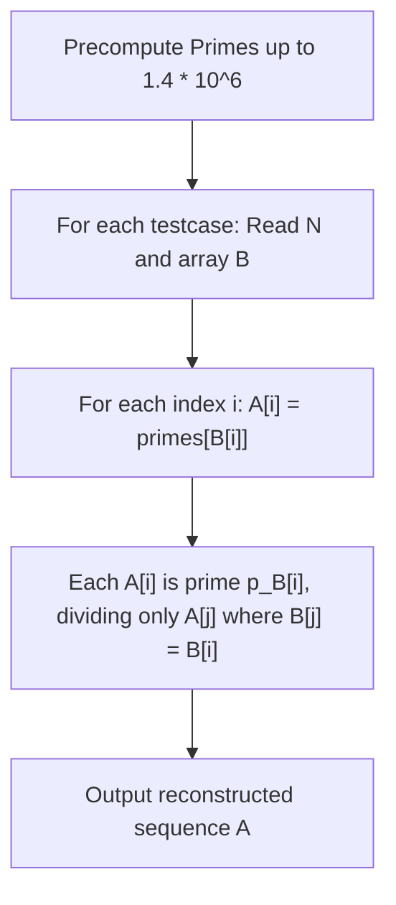

# Restore Sequence (CodeChef CC-RESTORE)

## 1. Problem Overview
- **Platform:** CodeChef
- **Problem ID:** [CC-RESTORE](https://www.codechef.com/problems/RESTORE)
- **Difficulty / Rating:** 1513
- **Tags:** codechef, number theory, prime sieve, constructive
- **Solution File:** `restoreSequence.js`
- **Starter Template:** `templates/codechef.js`

---

## 2. Core Intuition & Mathematical Rationale
### Key Observations
1. **Mathematical Invariant:** For each element $i$, $B_i$ denotes the largest index $j$ such that $A_i \mid A_j$. Since $A_i$ always divides itself, $B_i \ge i$, and $B_{B_i} = B_i$.
2. **Distinct Prime Construction:**
   - If we assign each index $j \in \{1, \ldots, N\}$ a distinct prime number $p_j$, then $p_j$ will only divide another number if that number contains $p_j$ in its prime factorization.
   - By setting $A_i = p_{B_i}$ for each $1 \le i \le N$, every element $A_i$ is a single prime number corresponding to its target $B_i$.
   - Consequently, $A_i$ divides $A_j$ if and only if $p_{B_i} \mid p_{B_j}$. Since all $p_k$ are distinct primes, this holds if and only if $B_i = B_j$.
   - The largest index $j$ such that $B_j = B_i$ is precisely $B_i$ itself.
   - Therefore, $B_i$ is uniquely the largest index $j$ such that $A_i \mid A_j$.
3. **Bound Verification:**
   - The $100,000$-th prime number is $1,299,709$.
   - This comfortably satisfies the problem constraint $A_i \le 4 \cdot 10^6$.

---

## 3. Visual Step-by-Step Walkthrough
### State Progression Matrix
Tracing $N = 5, B = [5, 2, 3, 4, 5]$:
- $p_1 = 2, p_2 = 3, p_3 = 5, p_4 = 7, p_5 = 11$.
- $A_1 = p_{B_1} = p_5 = 11$.
- $A_2 = p_{B_2} = p_2 = 3$.
- $A_3 = p_{B_3} = p_3 = 5$.
- $A_4 = p_{B_4} = p_4 = 7$.
- $A_5 = p_{B_5} = p_5 = 11$.
- Output: `11 3 5 7 11`.
- Divisibility verification:
  - $A_1 = 11$ divides $A_1, A_5$ (indices 1, 5; max index = 5).
  - $A_2 = 3$ divides $A_2$ (index 2; max index = 2).
  - $A_3 = 5$ divides $A_3$ (index 3; max index = 3).
  - $A_4 = 7$ divides $A_4$ (index 4; max index = 4).
  - $A_5 = 11$ divides $A_1, A_5$ (indices 1, 5; max index = 5).
- Machine produces $[5, 2, 3, 4, 5]$, perfectly matching $B$.

---

## 4. Algorithmic Complexity

| Dimension | Bound | Proof & Rationale |
|---|:---:|---|
| **Time Complexity** | $O(M \log \log M + \sum N)$ | Linear sieve precomputation up to $M = 1.4 \cdot 10^6$, followed by $O(1)$ lookup per element. |
| **Space Complexity** | $O(M + N)$ | Compact `Uint8Array` sieve and `Int32Array` output buffer. |
| **Numeric Safety** | Plain JS Numbers | Max value $1,299,709 \ll 2^{53} - 1$. |

---

## 5. Edge Cases & Boundary Conditions
- $N = 1$: Single element $A_1 = p_1 = 2$.
- All equal $B_i = N$: All elements assigned prime $p_N$.
- Identity $B_i = i$: Each element assigned distinct prime $p_i$.
