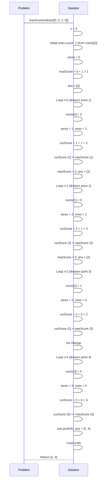

# All Divisions With the Highest Score of a Binary Array (LeetCode LC-2155)

## 1. Problem Overview
* Platform: LeetCode
* Problem ID: [2155](https://leetcode.com/problems/all-divisions-with-the-highest-score-of-a-binary-array/)
* Rating: Medium
* Tags: algorithms
* Solution File: `solutions/allDivisionsWithTheHighestScoreOfABinaryArray.js`

Given a binary array `nums`, we need to find all possible division points that result in the highest score. A division point `i` splits the array into `nums[0...i-1]` and `nums[i...n-1]`, and its score is the sum of zeros in the left part and ones in the right part.

## 2. Core Intuition & Mathematical Rationale

The key observation is that we can efficiently calculate the score for each division point by iterating through the array once. Instead of recalculating the number of zeros and ones for each division, we can maintain running counts.

A naive approach would be to iterate through all possible division points $i$ from $0$ to $n$. For each $i$, we would then iterate from $0$ to $i-1$ to count zeros and from $i$ to $n-1$ to count ones. This would result in an $O(N^2)$ time complexity, which is suboptimal for larger inputs.

The optimal approach starts by calculating the total number of ones in the entire array. This is our initial `ones` count for the right part when the division point is $0$ (left part is empty). The initial `zeros` count for the left part is $0$. The initial `maxScore` is `zeros + ones`. As we iterate through the array from left to right, moving the division point from $i$ to $i+1$:
* If `nums[i]` is $0$, it moves from the right part to the left part, so `zeros` increases by $1$.
* If `nums[i]` is $1$, it moves from the right part to the left part, so `ones` decreases by $1$.
We then update `maxScore` and `ans` array based on the `curScore = zeros + ones`. This allows us to calculate each score in $O(1)$ after an initial $O(N)$ pass, leading to an overall $O(N)$ solution.

```mermaid
flowchart TD
    A[Start] --> B{Calculate initial total ones};
    B --> C{Initialize zeros = 0};
    C --> D{Initialize maxScore = zeros + total ones};
    D --> E{Initialize ans = [0]};
    E --> F{Loop for i from 0 to n-1};
    F --> G{Is nums[i] == 0?};
    G -- Yes --> H[Increment zeros];
    G -- No --> I[Decrement ones];
    H --> J{Calculate curScore = zeros + ones};
    I --> J;
    J --> K{Is curScore > maxScore?};
    K -- Yes --> L[maxScore = curScore; ans = [i+1]];
    K -- No --> M{Is curScore == maxScore?};
    M -- Yes --> N[ans.push(i+1)];
    M -- No --> O[Continue];
    L --> O;
    N --> O;
    O --> P{End of loop?};
    P -- No --> F;
    P -- Yes --> Q[Return ans];
```

## 3. Visual Step-by-Step Walkthrough

**Sample Input:** `[0, 0, 1, 0]`

1.  **Initialization:**
    *   `n = 4`
    *   Initial pass to count total ones: `ones = 1` (from `nums[2]`).
    *   `zeros = 0` (for the left part before any division)
    *   `maxScore = zeros + ones = 0 + 1 = 1`
    *   `ans = [0]` (division at index 0, left part is empty, right part is `[0, 0, 1, 0]`)

2.  **Loop `i = 0` (division point `i+1 = 1`)**:
    *   `nums[0] = 0`.
    *   `zeros` becomes `0 + 1 = 1`.
    *   `ones` remains `1`.
    *   `curScore = zeros + ones = 1 + 1 = 2`.
    *   `curScore (2) > maxScore (1)`.
    *   `maxScore = 2`.
    *   `ans = [1]`.

3.  **Loop `i = 1` (division point `i+1 = 2`)**:
    *   `nums[1] = 0`.
    *   `zeros` becomes `1 + 1 = 2`.
    *   `ones` remains `1`.
    *   `curScore = zeros + ones = 2 + 1 = 3`.
    *   `curScore (3) > maxScore (2)`.
    *   `maxScore = 3`.
    *   `ans = [2]`.

4.  **Loop `i = 2` (division point `i+1 = 3`)**:
    *   `nums[2] = 1`.
    *   `zeros` remains `2`.
    *   `ones` becomes `1 - 1 = 0`.
    *   `curScore = zeros + ones = 2 + 0 = 2`.
    *   `curScore (2) < maxScore (3)`. No change to `maxScore` or `ans`.

5.  **Loop `i = 3` (division point `i+1 = 4`)**:
    *   `nums[3] = 0`.
    *   `zeros` becomes `2 + 1 = 3`.
    *   `ones` remains `0`.
    *   `curScore = zeros + ones = 3 + 0 = 3`.
    *   `curScore (3) === maxScore (3)`.
    *   `ans.push(4)`.
    *   `ans` becomes `[2, 4]`.

6.  **End of loop.** Return `ans = [2, 4]`.



## 4. Algorithmic Complexity

*   **Time per test:** $O(N)$, where $N$ is the length of `nums`. This is because there is one initial pass to count total ones, and then a single loop iterating through `nums` once. Each operation inside the loop is $O(1)$.
*   **Total time:** $O(N)$ for a single test case. If there are $T$ test cases, total time would be $O(T \cdot N_{max})$.
*   **Space:** $O(N)$ in the worst case for the `ans` array. In the worst case, all division points could have the same maximum score (e.g., all zeros or all ones arrays), requiring `N+1` elements in `ans`.
*   **Recursion depth:** $O(1)$ as the solution is iterative.

## 5. Edge Cases & Boundary Conditions

*   **Minimum input array length:** `nums` can have a length of 1.
    *   `nums = [0]`:
        *   Initial: `ones=0`, `zeros=0`, `maxScore=0`, `ans=[0]`
        *   `i=0`: `nums[0]=0`. `zeros=1`, `ones=0`. `curScore=1`. `maxScore=1`, `ans=[1]`.
        *   Returns `[1]`. Correct (0 zeros left, 0 ones right).
    *   `nums = [1]`:
        *   Initial: `ones=1`, `zeros=0`, `maxScore=1`, `ans=[0]`
        *   `i=0`: `nums[0]=1`. `zeros=0`, `ones=0`. `curScore=0`. `curScore < maxScore`. No change.
        *   Returns `[0]`. Correct (0 zeros left, 1 one right).
*   **Maximum input array length:** The problem statement implies $N \le 10^5$.
    *   The `zeros`, `ones`, and `curScore` variables will store counts up to $N$. Given $N=10^5$, these values easily fit within standard integer types (like JavaScript's numbers, which are 64-bit floats and can precisely represent integers up to $2^{53}-1$).
    *   The `ans` array can hold up to $N+1$ elements. For $N=10^5$, this is $100001$ elements, each being an index up to $10^5$. This is a manageable amount of data for memory.
*   **Degenerate shapes:**
    *   `nums` contains all zeros (e.g., `[0, 0, 0]`):
        *   Initial: `ones=0`, `zeros=0`, `maxScore=0`, `ans=[0]`
        *   `i=0`: `nums[0]=0`. `zeros=1`, `ones=0`. `curScore=1`. `maxScore=1`, `ans=[1]`.
        *   `i=1`: `nums[1]=0`. `zeros=2`, `ones=0`. `curScore=2`. `maxScore=2`, `ans=[2]`.
        *   `i=2`: `nums[2]=0`. `zeros=3`, `ones=0`. `curScore=3`. `maxScore=3`, `ans=[3]`.
        *   Returns `[3]`. Correct.
    *   `nums` contains all ones (e.g., `[1, 1]`):
        *   Initial: `ones=2`, `zeros=0`, `maxScore=2`, `ans=[0]`
        *   `i=0`: `nums[0]=1`. `zeros=0`, `ones=1`. `curScore=1`. `curScore < maxScore`. No change.
        *   `i=1`: `nums[1]=1`. `zeros=0`, `ones=0`. `curScore=0`. `curScore < maxScore`. No change.
        *   Returns `[0]`. Correct.

## 6. Reference Implementation

```javascript
var maxScoreIndices = function(nums) {
  const n = nums.length;
  let ones = 0;
  for (let i = 0; i < n; i++) {
    if (nums[i] === 1) ones++;
  }

  let zeros = 0;
  let maxScore = zeros + ones;
  let ans = [0];

  for (let i = 0; i < n; i++) {
    if (nums[i] === 0) {
      zeros++;
    } else {
      ones--;
    }
    const curScore = zeros + ones;
    if (curScore > maxScore) {
      maxScore = curScore;
      ans = [i + 1];
    } else if (curScore === maxScore) {
      ans.push(i + 1);
    }
  }

  return ans;
};

var solve = maxScoreIndices;

if (require.main === module) {
  const fs = require('fs');
  try {
    const raw = fs.readFileSync(0, 'utf-8').trim();
    if (raw) {
      const parsed = JSON.parse(raw);
      console.log(JSON.stringify(solve(parsed)));
    }
  } catch (e) {}
}

module.exports = maxScoreIndices;
```