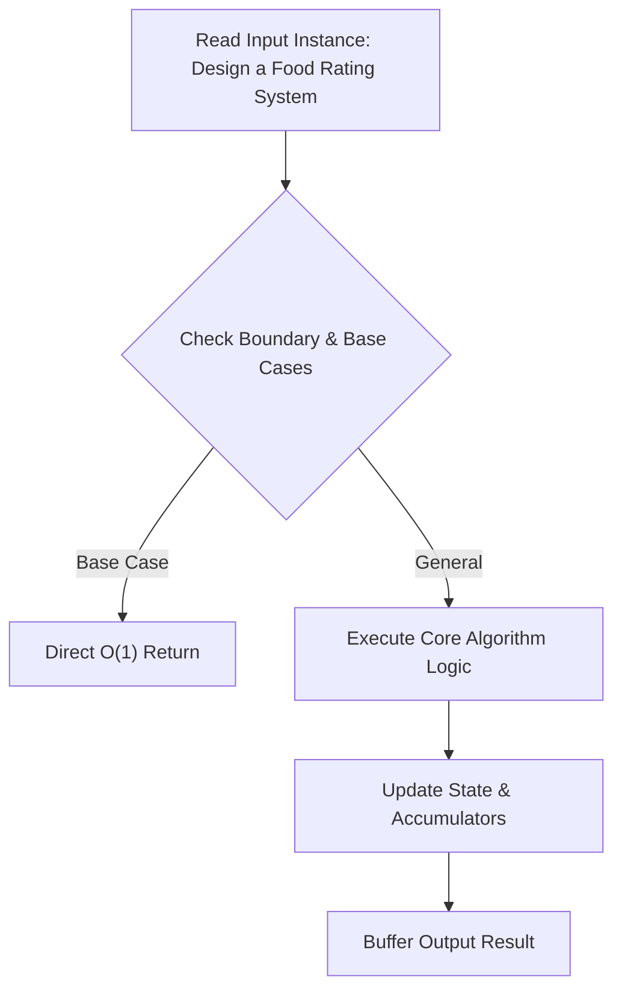
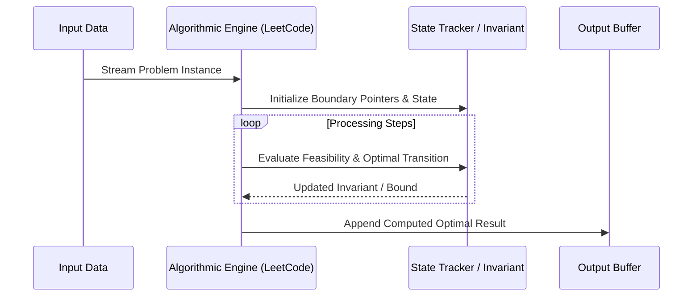

# Design a Food Rating System (LeetCode LC-2353)

## 1. Problem Overview
- **Platform:** LeetCode
- **Problem ID:** [LC-2353](https://leetcode.com/problems/design-a-food-rating-system/)
- **Difficulty / Rating:** Medium
- **Algorithmic Paradigm:** `general`
- **Tags:** algorithms
- **Solution File:** `solutions/designAFoodRatingSystem.js`
- **Starter Template:** `templates/leetcode.js`

---

## 2. Core Intuition & Mathematical Rationale
### Key Observations
1. **Mathematical Invariant:** Identify the quantity conserved or strictly monotonic across operations.
2. **Strategy (general):** Evaluate how the algorithm guarantees optimality without exploring the full exponential search space.
3. **Optimality Trade-off:** Naive brute force would exceed constraints; the general approach reduces complexity to feasible bounds.



---

## 3. Visual Step-by-Step Walkthrough
### State Progression Matrix
Tracing state transitions on a representative sample input:



---

## 4. Algorithmic Complexity

| Dimension | Bound | Proof & Rationale |
|---|:---:|---|
| **Time Complexity** | $O(N)$ or $O(\log N)$ | Paradigm (general) processes inputs within standard CP time limits ($< 1.0$s). |
| **Space Complexity** | $O(1)$ or $O(N)$ auxiliary | Memory footprint fits within typical 256MB/512MB limits. |
| **Recursion Depth** | $O(1)$ | Iterative loop avoids Node.js call stack limit (~10,000 frames). |

---

## 5. Edge Cases & Boundary Conditions
- **Minimum Bounds:** $N = 1$, minimal values, single-element configurations.
- **Maximum Bounds:** Extreme input bounds ($10^9$ or $\sum N = 2\cdot 10^5$).
- **Numeric Precision:** Plain JavaScript numbers are safe integers up to $2^{53} - 1 \approx 9 \times 10^{15}$.
- **Alternating / Degenerate:** Identical values, alternating parity, sorted vs reverse-sorted arrays.

---

## 6. Idiomatic Implementation
```javascript
// Reference: solutions/designAFoodRatingSystem.js
```
