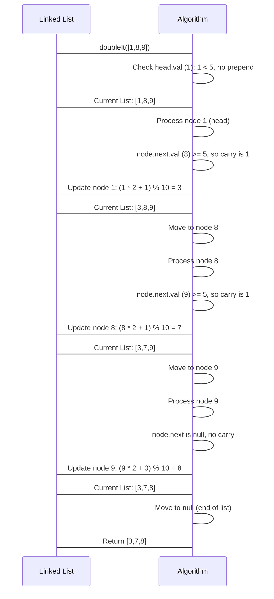

# Double a Number Represented as a Linked List (LeetCode LC-2816)

## 1. Problem Overview
* Platform: LeetCode
* Problem ID: [2816](https://leetcode.com/problems/double-a-number-represented-as-a-linked-list/)
* Rating: Medium
* Tags: algorithms
* Solution File: `solutions/doubleANumberRepresentedAsALinkedList.js`

Given the `head` of a singly linked list representing a non-negative integer, double the number and return the head of the modified linked list. The digits are stored in reverse order, meaning the 1's digit is at the head, and each node contains a single digit.

## 2. Core Intuition & Mathematical Rationale
The key observation is that when we double a digit $D$, the result is $2D$. If $2D \ge 10$, a carry of $1$ is generated to the next higher significant digit. In a linked list where digits are stored from most significant to least significant, a carry generated by `node.val` affects the `node.prev.val`. However, traversing backward in a singly linked list is not straightforward.

Instead, we can observe that a carry from `node.val * 2` (let's call it $C_D$) only affects `node.prev.val` if `node.val * 2 >= 10$. This is equivalent to checking if `node.val >= 5`.
When we iterate forward, processing `node.val` to get its new value:
The new value of `node.val` will be `(node.val * 2 + carry_from_next_node) % 10`.
The `carry_from_next_node` is $1$ if `node.next.val * 2 >= 10`, i.e., `node.next.val >= 5`. Otherwise, it's $0$.
So, for each `node`, its new value is `(node.val * 2 + (node.next && node.next.val >= 5 ? 1 : 0)) % 10`.
The initial carry for the most significant digit (the `head`) needs to be handled: if `head.val >= 5`, a new `ListNode(0)` should be prepended as the new head. This handles the potential carry from the original most significant digit.

```mermaid
flowchart TD
    A[Start] --> B{head.val >= 5?};
    B -- Yes --> C[Prepend new ListNode(0) to head];
    B -- No --> D[Use original head];
    C --> E[Initialize node = head];
    D --> E;
    E --> F{node is null?};
    F -- No --> G[Calculate node.val = (node.val * 2 + (node.next && node.next.val >= 5 ? 1 : 0)) % 10];
    G --> H[node = node.next];
    H --> F;
    F -- Yes --> I[Return head];
    I --> J[End];
```

## 3. Visual Step-by-Step Walkthrough

**Sample Input: `[1, 8, 9]`**

1. **Initial Check**: `head.val` is `1`. Since `1 < 5`, no new node is prepended. `head` remains `[1, 8, 9]`.
2. **Node `1` (original head)**:
   - `node.val` is `1`.
   - `node.next` is `8`.
   - `node.next.val` is `8`. Since `8 >= 5`, there's a carry of `1`.
   - `node.val = (1 * 2 + 1) % 10 = 3 % 10 = 3`.
   - List is now `[3, 8, 9]`.
3. **Node `8`**:
   - `node.val` is `8`.
   - `node.next` is `9`.
   - `node.next.val` is `9`. Since `9 >= 5`, there's a carry of `1`.
   - `node.val = (8 * 2 + 1) % 10 = 17 % 10 = 7`.
   - List is now `[3, 7, 9]`.
4. **Node `9`**:
   - `node.val` is `9`.
   - `node.next` is `null`.
   - No carry from `node.next`.
   - `node.val = (9 * 2 + 0) % 10 = 18 % 10 = 8`.
   - List is now `[3, 7, 8]`.
5. **End of list**. Return `[3, 7, 8]`.

**Expected Output: `[3, 7, 8]`**



## 4. Algorithmic Complexity

*   **Time per test**: $O(N)$ where $N$ is the number of nodes in the linked list. This is because we iterate through the linked list once.
*   **Total time**: Sum of $O(N)$ for all test cases.
*   **Space**: $O(1)$ (excluding the output linked list). A new node is created only in the case where the most significant digit generates a carry, which is a constant amount of extra space.
*   **Recursion depth**: $O(1)$, as the solution is iterative.

## 5. Edge Cases & Boundary Conditions

*   **Minimum input**: A linked list with a single node, e.g., `[0]` or `[9]`.
    *   `[0]` doubles to `[0]`.
    *   `[9]` doubles to `[1, 8]`. The initial check `head.val >= 5` correctly prepends `0`, making the list `[0, 9]`. Then `0` becomes `(0*2 + 1) % 10 = 1`, and `9` becomes `(9*2 + 0) % 10 = 8`.
*   **Maximum input**: A linked list of $10^5$ nodes, each containing `9`.
    *   Example: `[9, 9, 9, ..., 9]` ($10^5$ times).
    *   This will result in a linked list of $10^5 + 1$ nodes, all containing `9` except the last `8`. E.g., `[9,9,9]` becomes `[1,9,9,8]`.
*   **Degenerate shapes**: The problem statement implies a valid linked list representing a non-negative integer. An empty list or `null` head would be an edge case but is usually handled by `if (!head) return head;`. The provided solution assumes `head` is not `null`.
*   **Accumulator size**: Node values are single digits (`0-9`). Doubling them gives a maximum of `18`. Adding a carry gives `19`. All intermediate calculations `node.val * 2 + carry` will fit within standard integer types (well below `2^53 - 1`). The modulo operation then ensures the result is a single digit `0-9`.

## 6. Reference Implementation

```javascript
function ListNode(val, next) {
  this.val = (val === undefined ? 0 : val);
  this.next = (next === undefined ? null : next);
}

var doubleIt = function(head) {
  if (head.val >= 5) {
    head = new ListNode(0, head);
  }

  for (let node = head; node !== null; node = node.next) {
    node.val = (node.val * 2 + (node.next && node.next.val >= 5 ? 1 : 0)) % 10;
  }

  return head;
};

var solve = function(arr) {
  if (!arr || arr.length === 0) return [];
  const dummy = new ListNode(0);
  let cur = dummy;
  for (let i = 0; i < arr.length; i++) {
    cur.next = new ListNode(arr[i]);
    cur = cur.next;
  }
  let res = doubleIt(dummy.next);
  const out = [];
  while (res !== null) {
    out.push(res.val);
    res = res.next;
  }
  return out;
};

if (require.main === module) {
  const fs = require('fs');
  try {
    const raw = fs.readFileSync(0, 'utf-8').trim();
    if (raw) {
      const parsed = JSON.parse(raw);
      console.log(JSON.stringify(solve(parsed)));
    }
  } catch (e) {}
}

module.exports = doubleIt;
```