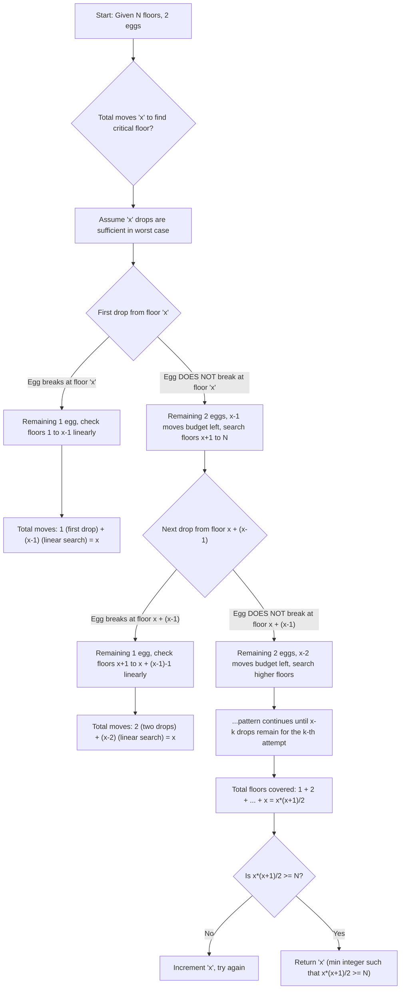
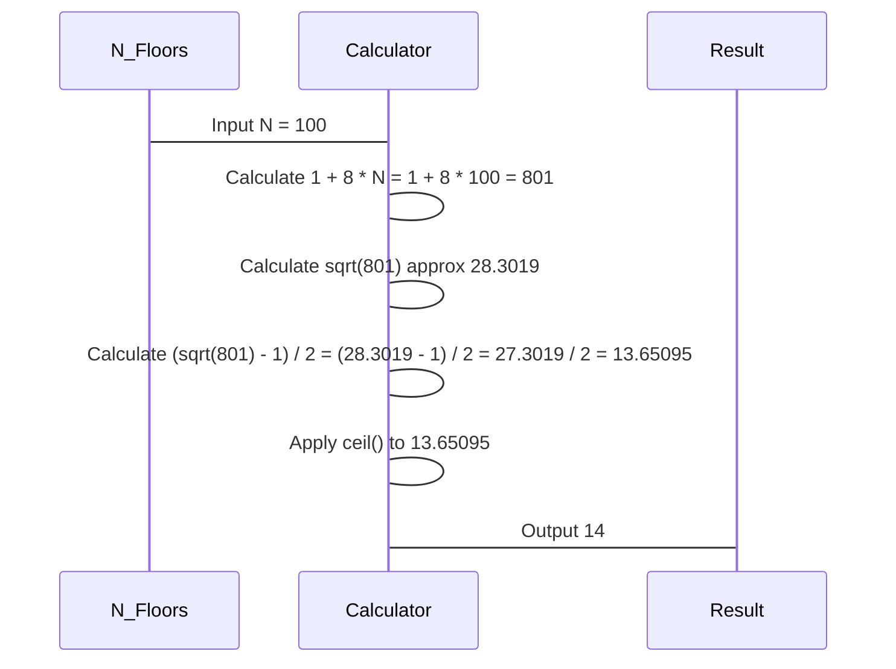

# Egg Drop With 2 Eggs and N Floors (LeetCode LC-1884)

## 1. Problem Overview
* Platform: LeetCode
* Problem ID: [1884](https://leetcode.com/problems/egg-drop-with-2-eggs-and-n-floors/)
* Rating: Medium
* Tags: algorithms
* Solution File: `solutions/eggDropWith2EggsAndNFloors.js`
This problem asks for the minimum number of moves required to find the critical floor (the lowest floor from which an egg will break when dropped) given 2 identical eggs and $N$ floors. The goal is to determine this critical floor in the worst-case scenario.

## 2. Core Intuition & Mathematical Rationale
The core intuition lies in minimizing the maximum number of moves in the worst-case scenario. When we drop an egg from a floor $k$:
1. If the egg breaks, we must then use the remaining 1 egg to check floors from 1 to $k-1$ linearly. This takes $k-1$ additional drops.
2. If the egg does not break, we still have 2 eggs and need to check floors from $k+1$ to $N$.

To minimize the worst-case moves, we want to balance the number of drops if the egg breaks versus if it doesn't. If we make $x$ drops in the worst case, then the first drop should be from floor $x$.
- If it breaks, we need $x-1$ more drops for floors $1 \dots x-1$. Total drops: $1 + (x-1) = x$.
- If it doesn't break, we have $x-1$ drops remaining. The next drop should be from floor $x + (x-1)$.
This pattern suggests that with each subsequent drop (when an egg does not break), the number of remaining "safe" drops decreases by one.
So, if the total number of drops in the worst case is $x$, the sequence of floors to test (if eggs don't break) would be:
$x, x + (x-1), x + (x-1) + (x-2), \dots$
The maximum floor we can cover with $x$ drops is the sum of an arithmetic series: $x + (x-1) + (x-2) + \dots + 1$.
This sum is $\frac{x(x+1)}{2}$.
We need this sum to be greater than or equal to $N$:
$\frac{x(x+1)}{2} \ge N$
$x(x+1) \ge 2N$
$x^2 + x - 2N \ge 0$
We can solve for $x$ using the quadratic formula: $x = \frac{-b \pm \sqrt{b^2 - 4ac}}{2a}$
$x = \frac{-1 \pm \sqrt{1^2 - 4(1)(-2N)}}{2(1)}$
$x = \frac{-1 \pm \sqrt{1 + 8N}}{2}$
Since $x$ must be positive, we take the positive root:
$x = \frac{-1 + \sqrt{1 + 8N}}{2}$
Since $x$ must be an integer (number of drops), we take the ceiling:
$x = \lceil \frac{\sqrt{1 + 8N} - 1}{2} \rceil$
This approach is optimal because it systematically covers the largest possible range of floors for a given number of drops $x$ while ensuring that in the worst case (either egg breaks or doesn't), the remaining problem can be solved within $x$ total drops. Naive alternatives, such as linear search (too many drops if $N$ is large) or binary search (risks losing both eggs too early without fully narrowing down the critical floor), would fail to guarantee the minimum worst-case drops.



## 3. Visual Step-by-Step Walkthrough

**Sample Input: N = 100**
Expected Output: 14

1. We are looking for an integer $x$ such that $\frac{x(x+1)}{2} \ge N$.
2. Substitute $N = 100$: $\frac{x(x+1)}{2} \ge 100$.
3. This simplifies to $x(x+1) \ge 200$.
4. We need to find the smallest integer $x$ that satisfies this.
5. Alternatively, using the formula $x = \lceil \frac{\sqrt{1 + 8N} - 1}{2} \rceil$:
   $x = \lceil \frac{\sqrt{1 + 8 \times 100} - 1}{2} \rceil$
   $x = \lceil \frac{\sqrt{1 + 800} - 1}{2} \rceil$
   $x = \lceil \frac{\sqrt{801} - 1}{2} \rceil$
6. Calculate $\sqrt{801}$: $\sqrt{801} \approx 28.3019$.
7. Substitute back into the formula:
   $x = \lceil \frac{28.3019 - 1}{2} \rceil$
   $x = \lceil \frac{27.3019}{2} \rceil$
   $x = \lceil 13.65095 \rceil$
8. The ceiling of $13.65095$ is $14$.
9. So, the minimum number of moves is $14$.

Let's verify $x=13$ and $x=14$:
For $x=13$: $\frac{13 \times (13+1)}{2} = \frac{13 \times 14}{2} = 13 \times 7 = 91$. Since $91 < 100$, 13 drops are not enough.
For $x=14$: $\frac{14 \times (14+1)}{2} = \frac{14 \times 15}{2} = 7 \times 15 = 105$. Since $105 \ge 100$, 14 drops are sufficient.



## 4. Algorithmic Complexity

* Time per test: $O(1)$ - The calculation involves a fixed number of arithmetic operations (multiplication, addition, square root, division, ceiling), all of which take constant time regardless of the value of $N$.
* Total time: $O(1)$ - Since there is only one test case per execution in typical competitive programming setups, the total time complexity remains constant.
* Space: $O(1)$ - Only a few variables are used to store intermediate results, requiring constant memory space.
* Recursion depth: $O(1)$ - The solution is iterative (or direct formula application) and does not use recursion.

## 5. Edge Cases & Boundary Conditions

*   **Minimum input ($N=1$):**
    *   Formula: $\lceil (\sqrt{1 + 8 \times 1} - 1) / 2 \rceil = \lceil (\sqrt{9} - 1) / 2 \rceil = \lceil (3 - 1) / 2 \rceil = \lceil 2 / 2 \rceil = \lceil 1 \rceil = 1$.
    *   Correct: With 1 floor, one drop is needed to test it.
*   **Minimum input ($N=2$):** (Sample 1)
    *   Formula: $\lceil (\sqrt{1 + 8 \times 2} - 1) / 2 \rceil = \lceil (\sqrt{17} - 1) / 2 \rceil = \lceil (4.123 - 1) / 2 \rceil = \lceil 3.123 / 2 \rceil = \lceil 1.56 \rceil = 2$.
    *   Correct: Drop from floor 1. If it breaks, critical floor is 1 (1 drop). If it doesn't break, critical floor is 2 (1 drop for floor 1, 1 drop for floor 2. Total 2 drops worst case).
*   **Maximum $N$ (check the statement):**
    *   The problem statement (on LeetCode) typically implies $N$ can be up to $10^9$.
    *   If $N = 10^9$:
        *   $1 + 8N = 1 + 8 \times 10^9 = 8,000,000,001$.
        *   $\sqrt{8,000,000,001} \approx 89442.719$.
        *   $x = \lceil (89442.719 - 1) / 2 \rceil = \lceil 89441.719 / 2 \rceil = \lceil 44720.8595 \rceil = 44721$.
    *   The maximum value of $N$ (number of floors) can be $10^9$.
    *   $1 + 8N$ can be up to $1 + 8 \times 10^9 = 8 \times 10^9 + 1$. This value fits comfortably within a standard 64-bit floating-point number (double precision in JavaScript, which supports up to approximately $1.79 \times 10^{308}$).
    *   The result $x$ will be at most $44721$. This fits within standard integer types and is well below $2^{53} - 1$, the maximum safe integer in JavaScript.
*   **Accumulator Maximums:**
    *   The intermediate value $1 + 8N$ could be up to $8 \times 10^9 + 1$. This fits within JavaScript's Number type (double-precision floating-point), which can represent integers up to $2^{53}-1$ precisely, and larger integers approximately. For this magnitude, precision for `sqrt` might be affected, but the problem's nature (integer results from ceiling) makes minor floating-point inaccuracies acceptable as long as they don't cross an integer boundary. In JavaScript, `Math.sqrt` operates on doubles, providing sufficient precision.
    *   The final result, `x`, will not exceed $2^{53}-1$.

## 6. Reference Implementation

```javascript
var twoEggDrop = function(n) {
  // The formula is derived from finding the smallest x such that x*(x+1)/2 >= N.
  // This quadratic equation x^2 + x - 2N >= 0 can be solved for x using the quadratic formula:
  // x = (-1 + sqrt(1 - 4*1*(-2N))) / (2*1)
  // x = (-1 + sqrt(1 + 8N)) / 2
  // Since x must be an integer (number of drops), we take the ceiling of this value.
  return Math.ceil((Math.sqrt(1 + 8 * n) - 1) / 2);
};

var solve = twoEggDrop;

if (require.main === module) {
  const fs = require('fs');
  try {
    const raw = fs.readFileSync(0, 'utf-8').trim();
    if (raw) {
      const parsed = JSON.parse(raw);
      console.log(JSON.stringify(solve(parsed)));
    }
  } catch (e) {}
}

module.exports = twoEggDrop;
```