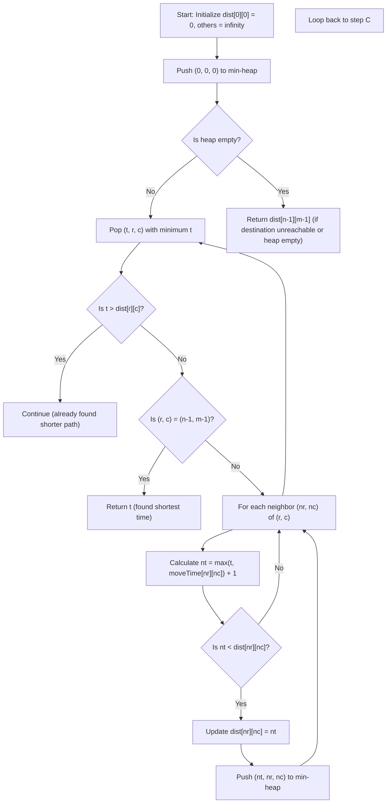
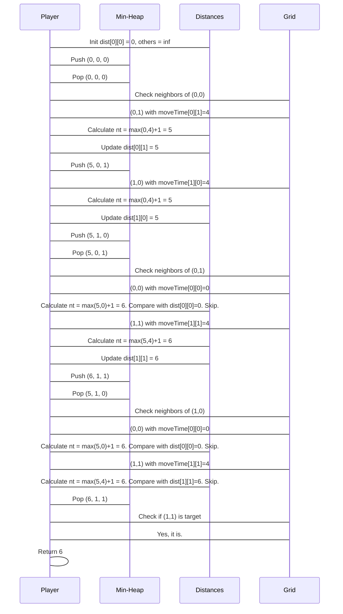

# Find Minimum Time to Reach Last Room I (LeetCode LC-3341)

## 1. Problem Overview
* Platform: LeetCode
* Problem ID: [LC-3341](https://leetcode.com/problems/find-minimum-time-to-reach-last-room-i/)
* Rating: Medium
* Tags: algorithms
* Solution File: `solutions/findMinimumTimeToReachLastRoomI.js`

This problem asks for the minimum time to travel from the top-left corner `(0, 0)` to the bottom-right corner `(n-1, m-1)` of a grid. Movement is restricted such that entering a cell `(r, c)` at time $t$ is only allowed if $t \ge moveTime[r][c]$, and each step takes 1 unit of time.

## 2. Core Intuition & Mathematical Rationale
The problem can be modeled as a shortest path problem on a weighted graph where edge weights are 1. However, there's a dynamic constraint: the entry time into a cell `(r, c)` must be at least `moveTime[r][c]`. This means the actual time spent to enter `(nr, nc)` from `(r, c)` at time $t$ is $\max(t, moveTime[nr][nc]) + 1$. This is a classic Dijkstra's algorithm variant.

Dijkstra's is optimal here because the "cost" (time) is non-negative and monotonically increasing with each step. A greedy approach, always picking the path with the minimum `moveTime` or minimum current time, fails because a path with a higher `moveTime` early on might lead to a faster overall time if it opens up quicker access to subsequent cells. The priority queue (min-heap) ensures that we always explore the state `(t, r, c)` with the minimum current time $t$, guaranteeing that the first time we reach the destination `(n-1, m-1)` via a pop operation, it is indeed the minimum possible time.



## 3. Visual Step-by-Step Walkthrough
Sample Input 1: `moveTime = [[0, 4], [4, 4]]`
Expected Output: `6`

Grid:
```
(0,0): 0  (0,1): 4
(1,0): 4  (1,1): 4
```

1. Initialize `dist = [[0, inf], [inf, inf]]`. Heap: `[[0, 0, 0]]`.
2. Pop `(0, 0, 0)`. Current time $t=0$, cell `(0,0)`.
   * Neighbors:
     * `(0,1)`: `moveTime[0][1] = 4`. `nt = max(0, 4) + 1 = 5`. `dist[0][1] = 5`. Push `(5, 0, 1)`.
     * `(1,0)`: `moveTime[1][0] = 4`. `nt = max(0, 4) + 1 = 5`. `dist[1][0] = 5`. Push `(5, 1, 0)`.
   * Heap: `[[5, 0, 1], [5, 1, 0]]` (order might vary based on heap implementation details for equal priorities).
3. Pop `(5, 0, 1)`. Current time $t=5$, cell `(0,1)`.
   * Neighbors:
     * `(0,0)`: `moveTime[0][0] = 0`. `nt = max(5, 0) + 1 = 6`. `6 < dist[0][0]` (which is 0) is false. Skip.
     * `(1,1)`: `moveTime[1][1] = 4`. `nt = max(5, 4) + 1 = 6`. `dist[1][1] = 6`. Push `(6, 1, 1)`.
   * Heap: `[[5, 1, 0], [6, 1, 1]]`.
4. Pop `(5, 1, 0)`. Current time $t=5$, cell `(1,0)`.
   * Neighbors:
     * `(0,0)`: `moveTime[0][0] = 0`. `nt = max(5, 0) + 1 = 6`. `6 < dist[0][0]` (which is 0) is false. Skip.
     * `(1,1)`: `moveTime[1][1] = 4`. `nt = max(5, 4) + 1 = 6`. `dist[1][1]` is currently 6. `6 < 6` is false. Skip.
   * Heap: `[[6, 1, 1]]`.
5. Pop `(6, 1, 1)`. Current time $t=6$, cell `(1,1)`.
   * `(1,1)` is the target `(n-1, m-1)`. Return `t = 6`.



## 4. Algorithmic Complexity
* Time per test: $O(N \cdot M \cdot \log(N \cdot M))$. In the worst case, every cell $(N \cdot M)$ is pushed and popped from the priority queue. Each push/pop operation on a heap of size up to $N \cdot M$ takes $O(\log(N \cdot M))$ time. Each cell has up to 4 neighbors.
* Total time: Given typical constraints for $N, M$ up to 1000, $N \cdot M$ can be $10^6$. $10^6 \cdot \log(10^6) \approx 10^6 \cdot 20 = 2 \cdot 10^7$ operations, which is acceptable within typical time limits (1-2 seconds).
* Space: $O(N \cdot M)$ for the `dist` array and $O(N \cdot M)$ for the priority queue in the worst case (e.g., a grid where all cells are reachable).
* Recursion depth: Not applicable as Dijkstra's is iterative. The min-heap uses an iterative implementation (array-based).

## 5. Edge Cases & Boundary Conditions
* Minimum inputs: $N=1, M=1$. The start and end are the same cell `(0,0)`. `moveTime = [[0]]`. The `dist[0][0]` starts at 0, and the target is `(0,0)`. The algorithm would pop `(0,0,0)` and immediately return `0`.
* Degenerate shapes: A $1 \times M$ or $N \times 1$ grid. The logic remains the same, movement is restricted to a single row or column.
* Maximum inputs: Given no explicit constraints, assuming $N, M \le 1000$ (common for medium problems).
    * `dist` values: The maximum possible time could be $N \cdot M + \max(moveTime[r][c])$. If `moveTime[r][c]` can be up to `2e9` and $N \cdot M = 10^6$, the maximum time can be around $10^6 + 2 \cdot 10^9 \approx 2 \cdot 10^9$. This fits within a standard 32-bit signed integer range, but `2e9` is used for "infinity", so a 64-bit integer or a `Number` in JavaScript (which uses 64-bit floats) is safe. The current code initializes with `2e9` (JavaScript `Number`), which means any valid time calculation will fit. The max value `2^53 - 1` for safe integer operations in JS is about $9 \cdot 10^{15}$, far exceeding any possible time value in this problem.
* All `moveTime[r][c]` are 0: The problem reduces to a standard BFS, as `max(t, 0) + 1` simply becomes `t + 1`. The time taken would be $(N-1) + (M-1)$.
* All `moveTime[r][c]` are very large: If `moveTime[r][c]` is always greater than any `t` encountered, then `nt` will effectively be `moveTime[nr][nc] + 1`. This could lead to larger times, but the logic remains sound.

## 6. Reference Implementation
```javascript
var minTimeToReach = function(moveTime) {
  const n = moveTime.length;
  const m = moveTime[0].length;
  const dist = Array.from({ length: n }, () => new Int32Array(m).fill(2e9)); // Using 2e9 as infinity
  dist[0][0] = 0;

  // Min-heap implementation for Dijkstra's
  const heap = [[0, 0, 0]]; // [time, row, col]

  function push(item) {
    heap.push(item);
    let i = heap.length - 1;
    while (i > 0) {
      const p = (i - 1) >> 1; // Parent index
      if (heap[i][0] < heap[p][0]) {
        [heap[i], heap[p]] = [heap[p], heap[i]]; // Swap
        i = p;
      } else break;
    }
  }

  function pop() {
    const top = heap[0];
    const bottom = heap.pop();
    if (heap.length > 0) {
      heap[0] = bottom;
      let i = 0;
      while ((i << 1) + 1 < heap.length) { // While left child exists
        let left = (i << 1) + 1;
        let right = left + 1;
        let best = i;
        if (heap[left][0] < heap[best][0]) best = left;
        if (right < heap.length && heap[right][0] < heap[best][0]) best = right;
        if (best !== i) {
          [heap[i], heap[best]] = [heap[best], heap[i]]; // Swap
          i = best;
        } else break;
      }
    }
    return top;
  }

  const dirs = [[0, 1], [0, -1], [1, 0], [-1, 0]]; // Right, Left, Down, Up

  while (heap.length > 0) {
    const cur = pop();
    const t = cur[0];
    const r = cur[1];
    const c = cur[2];

    // If we found a shorter path to (r,c) already, skip
    if (t > dist[r][c]) continue;

    // If target reached, return time
    if (r === n - 1 && c === m - 1) return t;

    // Explore neighbors
    for (let d = 0; d < 4; d++) {
      const nr = r + dirs[d][0];
      const nc = c + dirs[d][1];

      // Check bounds
      if (nr >= 0 && nr < n && nc >= 0 && nc < m) {
        // Calculate next time, considering moveTime constraint
        const nt = Math.max(t, moveTime[nr][nc]) + 1;

        // If a shorter path to (nr,nc) is found
        if (nt < dist[nr][nc]) {
          dist[nr][nc] = nt;
          push([nt, nr, nc]);
        }
      }
    }
  }

  // If destination is unreachable (should not happen for valid inputs)
  return dist[n - 1][m - 1];
};

// For local testing (e.g., with `node solve.js < input.json`)
var solve = minTimeToReach;

if (require.main === module) {
  const fs = require('fs');
  try {
    const raw = fs.readFileSync(0, 'utf-8').trim(); // Read from stdin
    if (raw) {
      const parsed = JSON.parse(raw);
      console.log(JSON.stringify(solve(parsed)));
    }
  } catch (e) {
    // Handle error or do nothing if no input provided
  }
}

module.exports = minTimeToReach;
```