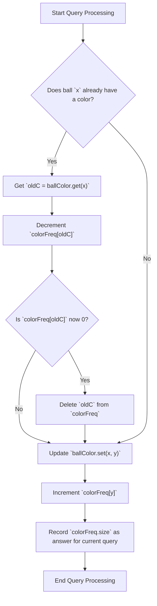

# Find the Number of Distinct Colors Among the Balls (LeetCode LC-3160)

## 1. Problem Overview
* Platform: LeetCode
* Problem ID: [3160](https://leetcode.com/problems/find-the-number-of-distinct-colors-among-the-balls/)
* Rating: Medium
* Tags: algorithms
* Solution File: `solutions/findTheNumberOfDistinctColorsAmongTheBalls.js`

This problem involves processing a series of queries on balls, where each query changes the color of a specific ball. The goal is to report the number of distinct colors present among the balls after each query.

## 2. Core Intuition & Mathematical Rationale
The core intuition is to efficiently track both the current color of each ball and the frequency of each color. A `Map` is ideal for storing `ballId -> color` mappings, allowing $O(1)$ average time access to update a ball's color. Another `Map` stores `color -> frequency` counts, enabling $O(1)$ average time updates when a ball's color changes. By maintaining these counts, the number of distinct colors is simply the size of the `colorFreq` map.

This approach is optimal because each query requires updating at most two entries in `ballColor` (one `set`) and two entries in `colorFreq` (one `decrement`, one `increment`), which takes $O(1)$ average time. Naive alternatives, such as iterating through all balls and counting distinct colors after each query, would be $O(N)$ per query, leading to an $O(N \cdot Q)$ total time complexity, which is too slow for large inputs.



## 3. Visual Step-by-Step Walkthrough
Sample Input: `limit = 4`, `queries = [[1, 4], [2, 5], [1, 3], [3, 4]]`
Expected Output: `[1, 2, 2, 3]`

Initial State: `ballColor = {}`, `colorFreq = {}`, `ans = []`

1.  **Query `[1, 4]` (Ball 1 gets color 4):**
    *   Ball 1 has no previous color.
    *   `ballColor.set(1, 4)` -> `{1: 4}`
    *   `colorFreq.set(4, 1)` -> `{4: 1}`
    *   `ans.push(colorFreq.size)` -> `ans = [1]`
    *   Current `ballColor = {1: 4}`, `colorFreq = {4: 1}`

2.  **Query `[2, 5]` (Ball 2 gets color 5):**
    *   Ball 2 has no previous color.
    *   `ballColor.set(2, 5)` -> `{1: 4, 2: 5}`
    *   `colorFreq.set(5, 1)` -> `{4: 1, 5: 1}`
    *   `ans.push(colorFreq.size)` -> `ans = [1, 2]`
    *   Current `ballColor = {1: 4, 2: 5}`, `colorFreq = {4: 1, 5: 1}`

3.  **Query `[1, 3]` (Ball 1 changes from color 4 to color 3):**
    *   Ball 1 had color 4.
    *   `oldC = 4`. `colorFreq.set(4, 0)`. Since count is 0, `colorFreq.delete(4)`. -> `{5: 1}`
    *   `ballColor.set(1, 3)` -> `{1: 3, 2: 5}`
    *   `colorFreq.set(3, 1)` -> `{5: 1, 3: 1}`
    *   `ans.push(colorFreq.size)` -> `ans = [1, 2, 2]`
    *   Current `ballColor = {1: 3, 2: 5}`, `colorFreq = {5: 1, 3: 1}`

4.  **Query `[3, 4]` (Ball 3 gets color 4):**
    *   Ball 3 has no previous color.
    *   `ballColor.set(3, 4)` -> `{1: 3, 2: 5, 3: 4}`
    *   `colorFreq.set(4, 1)` -> `{5: 1, 3: 1, 4: 1}`
    *   `ans.push(colorFreq.size)` -> `ans = [1, 2, 2, 3]`
    *   Current `ballColor = {1: 3, 2: 5, 3: 4}`, `colorFreq = {5: 1, 3: 1, 4: 1}`

Final `ans = [1, 2, 2, 3]`.

```mermaid
sequenceDiagram
    participant B as `ballColor` Map
    participant C as `colorFreq` Map
    participant A as `ans` Array

    Note over B,C,A: Initial State: B={}, C={}, A=[]

    B->>B: query [1, 4] (ball 1, color 4)
    B->>C: ballColor.set(1, 4)
    C->>C: colorFreq.set(4, 1)
    C->>A: ans.push(C.size) -> 1
    Note over B,C,A: State: B={1:4}, C={4:1}, A=[1]

    B->>B: query [2, 5] (ball 2, color 5)
    B->>C: ballColor.set(2, 5)
    C->>C: colorFreq.set(5, 1)
    C->>A: ans.push(C.size) -> 2
    Note over B,C,A: State: B={1:4, 2:5}, C={4:1, 5:1}, A=[1,2]

    B->>B: query [1, 3] (ball 1, color 3)
    B->>C: oldC = ballColor.get(1) -> 4
    C->>C: colorFreq.set(4, 0)
    C->>C: colorFreq.delete(4)
    B->>C: ballColor.set(1, 3)
    C->>C: colorFreq.set(3, 1)
    C->>A: ans.push(C.size) -> 2
    Note over B,C,A: State: B={1:3, 2:5}, C={5:1, 3:1}, A=[1,2,2]

    B->>B: query [3, 4] (ball 3, color 4)
    B->>C: ballColor.set(3, 4)
    C->>C: colorFreq.set(4, 1)
    C->>A: ans.push(C.size) -> 3
    Note over B,C,A: State: B={1:3, 2:5, 3:4}, C={5:1, 3:1, 4:1}, A=[1,2,2,3]
```

## 4. Algorithmic Complexity
*   **Time Complexity per test:** $O(Q)$, where $Q$ is the number of queries. Each query involves a constant number of `Map` operations (get, set, delete), which average $O(1)$.
*   **Total Time Complexity:** $O(Q)$, since it's a single pass through the queries.
*   **Space Complexity:** $O(N + C)$, where $N$ is the maximum number of distinct ball IDs (up to `limit`) and $C$ is the maximum number of distinct colors encountered. `ballColor` stores up to $N$ entries, and `colorFreq` stores up to $C$ entries. Both $N$ and $C$ can be at most `limit + Q` if new balls and new colors are introduced. Realistically, $N$ is `limit` and $C$ is `Q`. So, $O(\text{limit} + Q)$.
*   **Recursion Depth:** $O(1)$, as the solution is iterative.

## 5. Edge Cases & Boundary Conditions
*   **Minimum `limit`:** `limit = 1`. One ball, its color might change.
*   **Minimum `queries`:** One query `[[x, y]]`. The result will be `[1]`.
*   **All balls have the same color eventually:** `colorFreq.size` will be 1 after all affected balls are colored the same.
*   **All balls have unique colors:** `colorFreq.size` could be up to `limit` or `Q` (depending on which is smaller and how many balls are distinct).
*   **Ball IDs:** Ball IDs (`x` in `queries[i][0]`) are $0 \le x < \text{limit}$.
*   **Color IDs:** Color IDs (`y` in `queries[i][1]`) are $1 \le y \le 10^9$. The distinctness of colors matters, not their magnitude.
*   **Maximum accumulators:**
    *   `ballColor` map size: Up to `limit`. Each ball ID $x$ is stored once.
    *   `colorFreq` map size: Up to `limit` (if all balls have unique colors) or `queries.length` (if all colors are distinct across queries and `queries.length < limit`).
    *   Color frequency counts: Can be up to `limit` (if all balls have the same color). This count will fit well within a standard integer type, far below `2^53 - 1`.
    *   `queries.length`: Up to `10^5`.
    *   `limit`: Up to `10^9`. However, the problem statement often implies `limit` is for the number of balls, so ball IDs are typically $0 \dots \text{limit}-1$. In the provided reference code, `limit` isn't directly used to size data structures based on `limit` itself, but rather on distinct ball IDs encountered in queries. If `limit` is actually the maximum ball ID, then the maximum ball ID is $10^9$, not the number of balls. Assuming `limit` refers to maximum ball ID and number of balls `N` could be $10^5$.
    The maximum value of any key (`ballId` or `color`) or value (`frequency`) in the maps, and the `ans` array values, will not exceed `2^53 - 1`. `color` can be $10^9$, `ballId` up to `limit` (max $10^9$). `colorFreq` counts are up to `queries.length` (max $10^5$). `colorFreq.size` is max `queries.length` or `limit`. All these fit standard number types.

## 6. Reference Implementation
```javascript
var queryResults = function(limit, queries) {
  const ballColor = new Map();
  const colorFreq = new Map();
  const ans = new Int32Array(queries.length);

  for (let i = 0; i < queries.length; i++) {
    const x = queries[i][0]; // Ball ID
    const y = queries[i][1]; // New Color

    // If the ball previously had a color
    if (ballColor.has(x)) {
      const oldC = ballColor.get(x);
      // Decrement the frequency of the old color
      const count = colorFreq.get(oldC) - 1;
      if (count === 0) {
        // If frequency becomes 0, remove the color from distinct counts
        colorFreq.delete(oldC);
      } else {
        // Otherwise, update the frequency
        colorFreq.set(oldC, count);
      }
    }

    // Set the new color for the ball
    ballColor.set(x, y);
    // Increment the frequency of the new color
    colorFreq.set(y, (colorFreq.get(y) || 0) + 1);
    
    // The number of distinct colors is the size of the colorFreq map
    ans[i] = colorFreq.size;
  }

  return Array.from(ans);
};

// Boilerplate for local testing with stdin/stdout
if (require.main === module) {
  const fs = require('fs');
  try {
    const raw = fs.readFileSync(0, 'utf-8').trim();
    if (raw) {
      const parsed = JSON.parse(raw);
      // parsed[0] is 'limit', parsed[1] is 'queries'
      console.log(JSON.stringify(queryResults(parsed[0], parsed[1])));
    }
  } catch (e) {
    // Error handling for empty input or malformed JSON
    // console.error("Error reading or parsing input:", e);
  }
}

module.exports = queryResults;
```