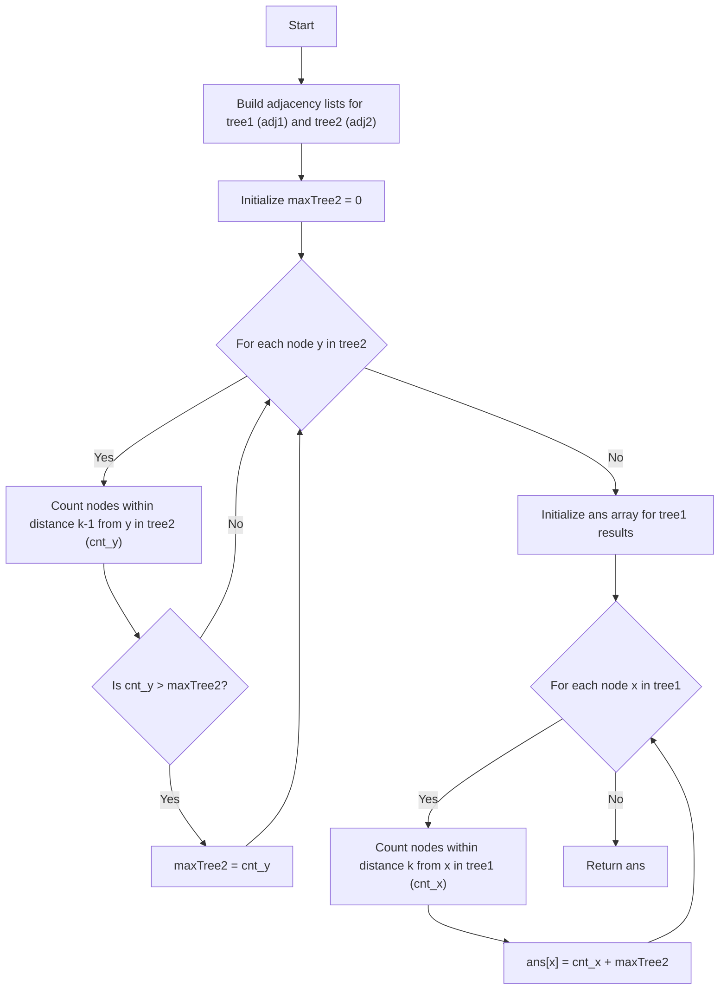
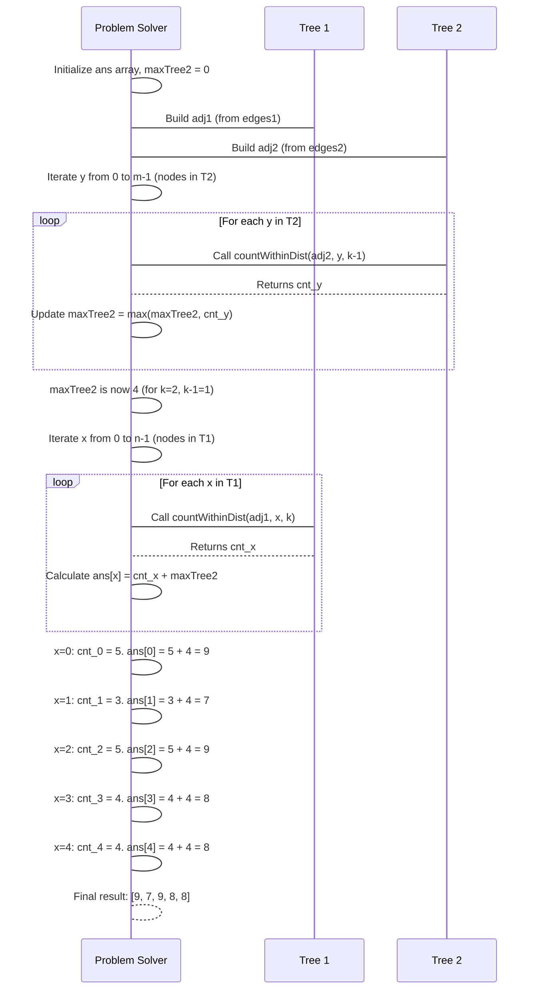

# Maximize the Number of Target Nodes After Connecting Trees I (LeetCode LC-3372)

## 1. Problem Overview
* Platform: LeetCode
* Problem ID: [LC-3372](https://leetcode.com/problems/maximize-the-number-of-target-nodes-after-connecting-trees-i/)
* Rating: Medium
* Tags: algorithms
* Solution File: `solutions/maximizeTheNumberOfTargetNodesAfterConnectingTreesI.js`
The problem asks us to find, for each possible connection point $x$ in tree 1, the maximum total number of nodes reachable within a distance $k$ after connecting tree 1 and tree 2. This involves choosing an optimal connection point $y$ in tree 2 to maximize the combined count.

## 2. Core Intuition & Mathematical Rationale
The core intuition is that when we connect a node $x$ from `tree1` and a node $y$ from `tree2` to form a new edge $(x, y)$, any path of length $d$ starting from $x$ in the combined graph can either stay entirely within `tree1` (length $d$), stay entirely within `tree2` (length $d$), or traverse the new edge $(x, y)$ once.

If a path starts at $x$ and stays within `tree1`, it reaches nodes within distance $d$ from $x$ in `tree1`.
If a path starts at $x$ and crosses to $y$ and then explores `tree2`, it uses 1 unit of distance to cross the edge $(x, y)$, leaving $d-1$ distance to explore from $y$ in `tree2`.
Since we want to maximize the total count for each $x$, the crucial observation is that the choice of $y$ in `tree2` to maximize the nodes reachable *from $y$ within distance $k-1$ in `tree2`* is independent of $x$. Therefore, we can pre-calculate the maximum number of nodes reachable within distance $k-1$ from *any* starting node $y$ in `tree2`. Let this maximum be $M_{tree2}$.
For each $x$ in `tree1`, the total count will then be the sum of nodes reachable within distance $k$ from $x$ in `tree1` *plus* $M_{tree2}$. This strategy is optimal because any chosen $x$ can always connect to the $y$ that yields $M_{tree2}$, maximizing the contribution from `tree2`.



## 3. Visual Step-by-Step Walkthrough
Sample Input 1:
`edges1 = [[0, 1], [0, 2], [2, 3], [2, 4]]` (n=5 nodes: 0, 1, 2, 3, 4)
`edges2 = [[0, 1], [0, 2], [0, 3], [2, 7], [1, 4], [4, 5], [4, 6]]` (m=8 nodes: 0..7)
`k = 2`

1. **Build Adjacency Lists:**
   `adj1 = [[1, 2], [0], [0, 3, 4], [2], [2]]`
   `adj2 = [[1, 2, 3], [0, 4], [0, 7], [0], [1, 5, 6], [4], [4], [2]]`

2. **Calculate `maxTree2` (nodes reachable within distance `k-1 = 1` in `tree2`):**
   * `y = 0`: `countWithinDist(adj2, 0, 1)`
     * Dist 0: {0} (1 node)
     * Dist 1: {1, 2, 3} (3 nodes)
     * Total: 1 + 3 = 4 nodes.
   * `y = 1`: `countWithinDist(adj2, 1, 1)`
     * Dist 0: {1} (1 node)
     * Dist 1: {0, 4} (2 nodes)
     * Total: 1 + 2 = 3 nodes.
   * `y = 2`: `countWithinDist(adj2, 2, 1)`
     * Dist 0: {2} (1 node)
     * Dist 1: {0, 7} (2 nodes)
     * Total: 1 + 2 = 3 nodes.
   * `y = 3`: `countWithinDist(adj2, 3, 1)`
     * Dist 0: {3} (1 node)
     * Dist 1: {0} (1 node)
     * Total: 1 + 1 = 2 nodes.
   * `y = 4`: `countWithinDist(adj2, 4, 1)`
     * Dist 0: {4} (1 node)
     * Dist 1: {1, 5, 6} (3 nodes)
     * Total: 1 + 3 = 4 nodes.
   * ... and so on for all `y` in `tree2`.
   The maximum count found is 4 (from `y=0` or `y=4`).
   `maxTree2 = 4`.

3. **Calculate `ans` for each node `x` in `tree1` (nodes reachable within distance `k = 2` in `tree1` + `maxTree2`):**
   * `x = 0`: `countWithinDist(adj1, 0, 2)`
     * Dist 0: {0} (1 node)
     * Dist 1: {1, 2} (2 nodes)
     * Dist 2: {3, 4} (2 nodes, from 2)
     * Total: 1 + 2 + 2 = 5 nodes.
     `ans[0] = 5 + maxTree2 = 5 + 4 = 9`.
   * `x = 1`: `countWithinDist(adj1, 1, 2)`
     * Dist 0: {1} (1 node)
     * Dist 1: {0} (1 node)
     * Dist 2: {2} (1 node, from 0)
     * Total: 1 + 1 + 1 = 3 nodes.
     `ans[1] = 3 + maxTree2 = 3 + 4 = 7`.
   * `x = 2`: `countWithinDist(adj1, 2, 2)`
     * Dist 0: {2} (1 node)
     * Dist 1: {0, 3, 4} (3 nodes)
     * Dist 2: {1} (1 node, from 0)
     * Total: 1 + 3 + 1 = 5 nodes.
     `ans[2] = 5 + maxTree2 = 5 + 4 = 9`.
   * `x = 3`: `countWithinDist(adj1, 3, 2)`
     * Dist 0: {3} (1 node)
     * Dist 1: {2} (1 node)
     * Dist 2: {0, 4} (2 nodes, from 2)
     * Total: 1 + 1 + 2 = 4 nodes.
     `ans[3] = 4 + maxTree2 = 4 + 4 = 8`.
   * `x = 4`: `countWithinDist(adj1, 4, 2)`
     * Dist 0: {4} (1 node)
     * Dist 1: {2} (1 node)
     * Dist 2: {0, 3} (2 nodes, from 2)
     * Total: 1 + 1 + 2 = 4 nodes.
     `ans[4] = 4 + maxTree2 = 4 + 4 = 8`.

Result: `[9, 7, 9, 8, 8]`



## 4. Algorithmic Complexity
* **Time per test:** $O(M \cdot (M + N_e) + N \cdot (N + M_e))$, where $N$ is the number of nodes in tree1, $M$ is the number of nodes in tree2, $N_e$ is the number of edges in tree1, and $M_e$ is the number of edges in tree2. In trees, $N_e = N-1$ and $M_e = M-1$. So it simplifies to $O(M^2 + N^2)$.
    * Building adjacency lists: $O(N_e + M_e)$
    * Calculating `maxTree2`: $M$ BFS runs. Each BFS runs on `adj2`, which is $O(M + M_e)$. Total: $O(M \cdot (M + M_e))$.
    * Calculating `ans`: $N$ BFS runs. Each BFS runs on `adj1`, which is $O(N + N_e)$. Total: $O(N \cdot (N + N_e))$.
* **Total time:** Sum of time per test over all test cases.
* **Space:** $O(N + M)$
    * Adjacency lists: $O(N + N_e + M + M_e)$
    * BFS queue and visited array: $O(max(N, M))$
    * `ans` array: $O(N)$
* **Recursion depth:** $O(1)$ (BFS is iterative).

## 5. Edge Cases & Boundary Conditions
* **Minimum inputs:**
    * `edges1` or `edges2` can be empty (meaning a single-node tree). If `edges1` is `[]`, `n = 1`. If `edges2` is `[]`, `m = 1`.
    * `k = 0`: `countWithinDist` with `maxDist = 0` will count only the root node itself (1). `maxTree2` calculation will use `k-1 = -1`, resulting in 0. So `ans[x]` will be 1 (for current node $x$) + 0 = 1.
    * `k = 1`: `maxTree2` calculation will use `k-1 = 0`, counting 1 for each root. `ans[x]` calculation will use `k = 1`, counting root + its neighbors.
* **Maximum inputs:** Check the problem statement for specific `N`, `M`, and `k` constraints. Assuming typical LeetCode tree constraints, $N, M \approx 10^5$. In this case, $O(N^2)$ would be too slow. The problem states "I", suggesting this is a simpler version with smaller constraints. If $N, M \approx 1000$, $O(N^2)$ would be $10^6$ operations, which is feasible.
* **Degenerate shapes:**
    * Single node tree (e.g., `edges1 = []`). `countWithinDist` from root 0 will correctly return 1 (if `k >= 0`).
    * Path graph: BFS will still correctly count nodes within distance `k`.
    * Star graph: BFS will still correctly count nodes within distance `k`.
* **Accumulator maximums:**
    * `count` in `countWithinDist` can be up to $N$ or $M$. These values will fit within standard integer types.
    * `maxTree2` will be at most $M$.
    * `ans[x]` will be at most $N + M$. All these values are well within `2^53 - 1`.

## 6. Reference Implementation
```javascript
var maxTargetNodes = function(edges1, edges2, k) {
  const n = edges1.length + 1;
  const m = edges2.length + 1;

  function buildAdj(edges, sz) {
    const adj = Array.from({ length: sz }, () => []);
    for (let i = 0; i < edges.length; i++) {
      const u = edges[i][0];
      const v = edges[i][1];
      adj[u].push(v);
      adj[v].push(u);
    }
    return adj;
  }

  const adj1 = buildAdj(edges1, n);
  const adj2 = buildAdj(edges2, m);

  function countWithinDist(adj, root, maxDist) {
    if (maxDist < 0) return 0;
    const q = [root];
    const visited = new Uint8Array(adj.length);
    visited[root] = 1;
    let dist = 0;
    let count = 0;
    let head = 0;

    while (head < q.length && dist <= maxDist) {
      const levelEnd = q.length;
      count += levelEnd - head;
      if (dist === maxDist) break;

      while (head < levelEnd) {
        const u = q[head++];
        for (let i = 0; i < adj[u].length; i++) {
          const v = adj[u][i];
          if (!visited[v]) {
            visited[v] = 1;
            q.push(v);
          }
        }
      }
      dist++;
    }

    return count;
  }

  let maxTree2 = 0;
  for (let y = 0; y < m; y++) {
    const cnt = countWithinDist(adj2, y, k - 1);
    if (cnt > maxTree2) maxTree2 = cnt;
  }

  const ans = new Int32Array(n);
  for (let x = 0; x < n; x++) {
    ans[x] = countWithinDist(adj1, x, k) + maxTree2;
  }

  return Array.from(ans);
};

var solve = maxTargetNodes;

if (require.main === module) {
  const fs = require('fs');
  try {
    const raw = fs.readFileSync(0, 'utf-8').trim();
    if (raw) {
      const parsed = JSON.parse(raw);
      console.log(JSON.stringify(solve(parsed[0], parsed[1], parsed[2])));
    }
  } catch (e) {}
}

module.exports = maxTargetNodes;
```