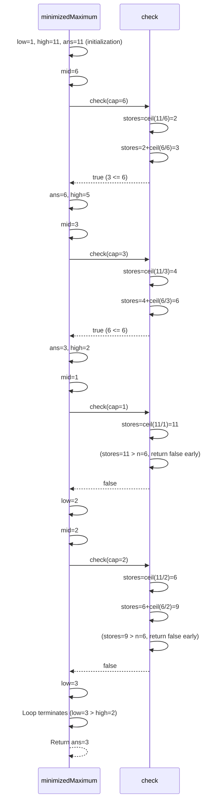

# Minimized Maximum of Products Distributed to Any Store (LeetCode LC-2064)

## 1. Problem Overview
* Platform: LeetCode
* Problem ID: [LC-2064](https://leetcode.com/problems/minimized-maximum-of-products-distributed-to-any-store/)
* Rating: Medium
* Tags: algorithms
* Solution File: `solutions/minimizedMaximumOfProductsDistributedToAnyStore.js`

Given `n` stores and an array `quantities` representing the quantities of different product types, the goal is to distribute all product types such that each store receives products of only one type, and the maximum quantity of products received by any single store is minimized. The problem asks for this minimized maximum quantity.

## 2. Core Intuition & Mathematical Rationale
The problem asks to find the minimum possible value for the maximum quantity distributed to any store. This structure often suggests a binary search on the answer. If it's possible to distribute all quantities such that no store receives more than $X$ products, it's also possible to do so for any $Y > X$. This monotonic property allows us to use binary search.

The `check(cap)` function is crucial. For a given `cap` (maximum quantity any store can receive), it determines if it's possible to distribute all product types using at most `n` stores. For each product type `q` in `quantities`, the number of stores required to distribute this type is $\lceil q / \text{cap} \rceil$. We sum these up for all product types. If the total number of stores needed is less than or equal to `n`, then `cap` is a feasible maximum, and we try to find a smaller `cap`. Otherwise, `cap` is too small, and we need a larger `cap`.

The optimality comes from the binary search effectively exploring the search space of possible maximums. Each `check(cap)` operation efficiently calculates the minimum stores needed for that `cap`. By repeatedly halving the search space, we converge on the smallest `cap` that satisfies the condition. Naive approaches, such as iterating through all possible maximums from 1 up to the largest quantity, would be too slow if the maximum quantity is large.

```mermaid
flowchart TD
    A["Start minimizedMaximum(n, quantities)"] --> B{"Initialize low = 1, high = max(quantities)"};
    B --> C{"Initialize ans = high"};
    C --> D{"While low <= high?"};
    D -- "True" --> E["mid = (low + high) >> 1"];
    E --> F{"Call check(mid)"};
    F -- "True (mid is feasible)" --> G["ans = mid"];
    G --> H["high = mid - 1 (try smaller cap)"];
    H --> D;
    F -- "False (mid is not feasible)" --> I["low = mid + 1 (need larger cap)"];
    I --> D;
    D -- "False" --> J["Return ans"];

    subgraph check(cap)
        K["stores = 0"] --> L{"For each q in quantities"};
        L --> M["stores += ceil(q / cap)"];
        M --> N{"If stores > n?"};
        N -- "True" --> O["Return false"];
        N -- "False" --> L;
        L --> P["Return stores <= n"];
    end
```

## 3. Visual Step-by-Step Walkthrough
Sample Input 1: `n = 6`, `quantities = [11, 6]`
Expected Output: `3`

1. **Initialization**:
   * `low = 1`
   * `high = max([11, 6]) = 11`
   * `ans = 11`

2. **Iteration 1**:
   * `low = 1`, `high = 11`
   * `mid = (1 + 11) >> 1 = 6`
   * `check(6)`:
     * `stores = 0`
     * For `q = 11`: `stores += Math.ceil(11 / 6) = 2`. (`stores = 2`)
     * For `q = 6`: `stores += Math.ceil(6 / 6) = 1`. (`stores = 3`)
     * `stores = 3`. Is `3 <= n=6`? Yes. `check(6)` returns `true`.
   * `ans = 6`
   * `high = 6 - 1 = 5`

3. **Iteration 2**:
   * `low = 1`, `high = 5`
   * `mid = (1 + 5) >> 1 = 3`
   * `check(3)`:
     * `stores = 0`
     * For `q = 11`: `stores += Math.ceil(11 / 3) = 4`. (`stores = 4`)
     * For `q = 6`: `stores += Math.ceil(6 / 3) = 2`. (`stores = 6`)
     * `stores = 6`. Is `6 <= n=6`? Yes. `check(3)` returns `true`.
   * `ans = 3`
   * `high = 3 - 1 = 2`

4. **Iteration 3**:
   * `low = 1`, `high = 2`
   * `mid = (1 + 2) >> 1 = 1`
   * `check(1)`:
     * `stores = 0`
     * For `q = 11`: `stores += Math.ceil(11 / 1) = 11`. (`stores = 11`)
     * `stores = 11`. Is `11 > n=6`? Yes. `check(1)` returns `false`.
   * `low = 1 + 1 = 2`

5. **Iteration 4**:
   * `low = 2`, `high = 2`
   * `mid = (2 + 2) >> 1 = 2`
   * `check(2)`:
     * `stores = 0`
     * For `q = 11`: `stores += Math.ceil(11 / 2) = 6`. (`stores = 6`)
     * For `q = 6`: `stores += Math.ceil(6 / 2) = 3`. (`stores = 9`)
     * `stores = 9`. Is `9 > n=6`? Yes. `check(2)` returns `false`.
   * `low = 2 + 1 = 3`

6. **End Condition**:
   * `low = 3`, `high = 2`. `low <= high` is `false`.
   * Loop terminates.

7. **Return `ans`**: `3`.



## 4. Algorithmic Complexity
* **Time per test**: $O(M \log Q_{max})$, where $M$ is the number of product types (`quantities.length`) and $Q_{max}$ is the maximum quantity in `quantities`. The binary search performs $\log Q_{max}$ iterations. In each iteration, the `check` function iterates through `quantities`, taking $O(M)$ time.
* **Total time**: $O(M \log Q_{max})$ as it's a single execution.
* **Space**: $O(1)$ auxiliary space. The input arrays are not modified, and only a few variables are used.
* **Recursion depth**: $O(1)$ as the solution is iterative. The maximum value for `mid` and `high` is $10^5$, fitting within standard integer types without overflow issues for calculation `(low + high) >> 1`.

## 5. Edge Cases & Boundary Conditions
* **Minimum `n`**: `n = 1`. In this case, all quantities must be distributed to a single store (or type of product per store), meaning the maximum quantity will simply be the sum of all quantities, or the largest single quantity if `n` allows it. The algorithm correctly handles this: `check(cap)` would require `quantities.length` stores if `cap` is very large. If `n=1`, it can only handle one store, so each product type would take one store. If `n=1` and `quantities = [100000]`, the answer is 100000. `check(cap)` for `100000` means `ceil(100000/100000)=1` store, which is `<= n`. `low` will eventually converge to 100000.
* **Maximum `n`**: `n` can be up to $10^5$. If `n` is very large (e.g., `n >= sum(quantities)` or `n >= quantities.length`), it means each product can go to its own store, possibly even individual items if `n` is large enough. The `check` function correctly calculates `Math.ceil(q / cap)` for each `q`. If `cap = 1`, it requires `sum(quantities)` stores. If `n` is very large, it means `cap = 1` is possible.
* **Minimum `quantities.length`**: `1`. The logic still holds. If `quantities = [Q]`, then `check(cap)` will simply be `ceil(Q / cap)`. The binary search finds the smallest `cap` such that `ceil(Q / cap) <= n`. This simplifies to `Q / cap <= n` for integer `cap`, or `cap >= Q / n`. The smallest integer `cap` is `ceil(Q / n)`.
* **Maximum `quantities[i]`**: $10^5$. The `high` value for binary search will be $10^5$.
* **Maximum sum of `quantities`**: $10^5 \times 10^5 = 10^{10}$, if `quantities` has $10^5$ elements, each $10^5$. `Math.ceil(quantities[i] / cap)` can be at most `quantities[i]`, and `stores` can accumulate up to `sum(quantities)`. `sum(quantities)` can be $10^{10}$, which fits in JavaScript's number type (double-precision floating point, up to $2^{53}-1 \approx 9 \times 10^{15}$). Thus, `stores` won't overflow.
* **`cap = 0`**: `low` is initialized to 1, so `cap` will always be at least 1, avoiding division by zero.

## 6. Reference Implementation
```javascript
var minimizedMaximum = function(n, quantities) {
  let low = 1;
  let high = 0;
  for (let i = 0; i < quantities.length; i++) {
    if (quantities[i] > high) high = quantities[i];
  }

  function check(cap) {
    let stores = 0;
    for (let i = 0; i < quantities.length; i++) {
      stores += Math.ceil(quantities[i] / cap);
      if (stores > n) return false;
    }
    return stores <= n;
  }

  let ans = high; // Initialize ans with a possible (though not necessarily optimal) maximum
  while (low <= high) {
    const mid = (low + high) >> 1; // Integer division
    if (check(mid)) {
      ans = mid; // mid is a possible answer, try for a smaller one
      high = mid - 1;
    } else {
      low = mid + 1; // mid is too small, need a larger cap
    }
  }

  return ans;
};

var solve = minimizedMaximum;

if (require.main === module) {
  const fs = require('fs');
  try {
    const raw = fs.readFileSync(0, 'utf-8').trim();
    if (raw) {
      const parsed = JSON.parse(raw);
      console.log(JSON.stringify(solve(parsed[0], parsed[1])));
    }
  } catch (e) {}
}

module.exports = minimizedMaximum;
```