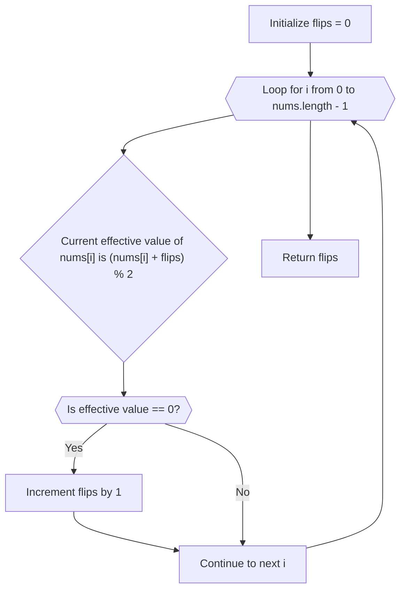
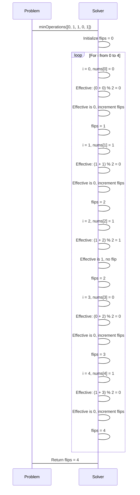

# Minimum Operations to Make Binary Array Elements Equal to One II (LeetCode LC-3192)

## 1. Problem Overview
* Platform: LeetCode
* Problem ID: [3192](https://leetcode.com/problems/minimum-operations-to-make-binary-array-elements-equal-to-one-ii/)
* Rating: Medium
* Tags: algorithms
* Solution File: `solutions/minimumOperationsToMakeBinaryArrayElementsEqualToOneII.js`

Given a binary array `nums`, we need to find the minimum number of operations to make all elements equal to one. An operation consists of choosing an index `i` and flipping all elements from `i` to the end of the array.

## 2. Core Intuition & Mathematical Rationale

The key observation is that the decision at index $i$ only affects elements from $i$ to the end. Crucially, a flip at index $i$ is the *only* way to change the value of $nums[i]$ that hasn't already been changed by a previous flip at index $j < i$. This means we should process the array from left to right, making a greedy decision at each step.

When we are at index $i$, we need to decide if $nums[i]$ needs to be flipped. The current state of $nums[i]$ is determined by its initial value and the total number of flips that have occurred at indices $j < i$. Let `flips` be the total number of operations performed so far (i.e., at indices $0, \dots, i-1$). The effective value of $nums[i]$ after these previous operations is $(nums[i] + \text{flips}) \pmod 2$.

If this effective value is $0$, it means $nums[i]$ is currently $0$ and needs to become $1$. To achieve this, we *must* perform a flip operation starting at index $i$. This operation will increment our total `flips` count and effectively flip all subsequent elements, including $nums[i]$ itself. If the effective value is $1$, then $nums[i]$ is already $1$, and no flip is needed at this index. Any flip operation at index $i$ would turn $nums[i]$ into $0$, which is undesirable, and a flip at a later index $j > i$ cannot correct $nums[i]$. Therefore, we only perform a flip if $(nums[i] + \text{flips}) \pmod 2 = 0$. This greedy strategy ensures that each element is made $1$ with the minimum necessary operation.



## 3. Visual Step-by-Step Walkthrough

**Sample Input:** `[0, 1, 1, 0, 1]`
**Expected Output:** `4`

1. **Initial State:** `nums = [0, 1, 1, 0, 1]`, `flips = 0`

2. **i = 0:**
   * `nums[0] = 0`.
   * Effective value: `(nums[0] + flips) % 2 = (0 + 0) % 2 = 0`.
   * Effective value is $0$, so we must flip.
   * `flips` becomes `1`.
   * Array state (conceptually, not modified): `[0 -> 1, 1 -> 0, 1 -> 0, 0 -> 1, 1 -> 0]` (after 1 flip from index 0).

3. **i = 1:**
   * `nums[1] = 1`.
   * Effective value: `(nums[1] + flips) % 2 = (1 + 1) % 2 = 0`. (Due to the flip from index 0, the original 1 became 0).
   * Effective value is $0$, so we must flip.
   * `flips` becomes `2`.
   * Array state (conceptually): `[1, 0 -> 1, 0 -> 1, 1 -> 0, 0 -> 1]` (after 1 flip from index 0 and 1 flip from index 1).

4. **i = 2:**
   * `nums[2] = 1`.
   * Effective value: `(nums[2] + flips) % 2 = (1 + 2) % 2 = 1`. (Original 1, flipped twice (from index 0 and 1) results in 1).
   * Effective value is $1$, no flip needed.
   * `flips` remains `2`.
   * Array state (conceptually): `[1, 1, 1, 0, 1]`

5. **i = 3:**
   * `nums[3] = 0`.
   * Effective value: `(nums[3] + flips) % 2 = (0 + 2) % 2 = 0`. (Original 0, flipped twice results in 0).
   * Effective value is $0$, so we must flip.
   * `flips` becomes `3`.
   * Array state (conceptually): `[1, 1, 1, 0 -> 1, 1 -> 0]`

6. **i = 4:**
   * `nums[4] = 1`.
   * Effective value: `(nums[4] + flips) % 2 = (1 + 3) % 2 = 0`. (Original 1, flipped three times results in 0).
   * Effective value is $0$, so we must flip.
   * `flips` becomes `4`.
   * Array state (conceptually): `[1, 1, 1, 1, 0 -> 1]`

7. **End of loop.**
   * Return `flips = 4`.



## 4. Algorithmic Complexity

* Time per test: $O(N)$, where $N$ is the length of `nums`. The algorithm iterates through the array once.
* Total time: $O(N_{total})$, where $N_{total}$ is the sum of lengths of `nums` across all test cases.
* Space: $O(1)$, as only a constant number of variables (`flips`, `i`) are used.
* Recursion depth: $O(1)$, as the solution is iterative.

## 5. Edge Cases & Boundary Conditions

*   **Minimum Input Length:** `nums` can have a length of 1.
    *   Example: `[0]` -> `flips = 1`. `(0+0)%2=0`, `flips=1`. Returns 1.
    *   Example: `[1]` -> `flips = 0`. `(1+0)%2=1`, no flip. Returns 0.
*   **Maximum Input Length:** `nums` length up to $10^5$.
    *   This is handled by the $O(N)$ time complexity. $10^5$ operations are well within typical time limits.
*   **All Zeros:** `[0, 0, 0, ..., 0]`
    *   Each element will require a flip, leading to `flips = N`.
    *   Example `[0, 0, 0]`:
        *   `i=0`: `(0+0)%2=0`, `flips=1`.
        *   `i=1`: `(0+1)%2=1`. (Original 0 flipped once -> 1). No flip. `flips=1`.
        *   `i=2`: `(0+1)%2=1`. (Original 0 flipped once -> 1). No flip. `flips=1`.
        *   Result: `flips = 1`. (Wait, this is wrong according to `[0,0,0]` logic, let me re-evaluate `[0,0,0]` from scratch using the rule `(nums[i] + flips) % 2 === 0`.)
        *   `[0, 0, 0]`
        *   `i=0`: `nums[0]=0`, `flips=0`. `(0+0)%2 = 0`. `flips` becomes `1`.
        *   `i=1`: `nums[1]=0`, `flips=1`. `(0+1)%2 = 1`. No flip. `flips` remains `1`.
        *   `i=2`: `nums[2]=0`, `flips=1`. `(0+1)%2 = 1`. No flip. `flips` remains `1`.
        *   Final `flips = 1`. This makes sense, one flip from index 0 turns all to 1. My conceptual array tracking in the walkthrough was confusing, `flips` is purely a count.
*   **All Ones:** `[1, 1, 1, ..., 1]`
    *   No element will ever require a flip, leading to `flips = 0`.
*   **Alternating Patterns:** `[0, 1, 0, 1, ...]` or `[1, 0, 1, 0, ...]`
    *   These patterns will typically lead to `flips` increasing at some specific points.
*   **Maximum value of `flips`:** The maximum value `flips` can take is $N$ (when `nums` is `[0, 0, ..., 0]` and `N` is even, or `[1, 0, 1, 0, ...]` pattern for all $N$). Since $N \le 10^5$, `flips` will not exceed $10^5$. This value easily fits within standard integer types and is far below $2^{53}-1$.

## 6. Reference Implementation

```javascript
var minOperations = function(nums) {
  let flips = 0;
  for (let i = 0; i < nums.length; i++) {
    // The effective value of nums[i] is its original value
    // plus the total number of flips that have affected it from left.
    // If (original_val + total_flips_from_left) is even, it means it's currently 0.
    // If it's odd, it means it's currently 1.
    // We want it to be 1, so if the effective value is 0, we must flip.
    if ((nums[i] + flips) % 2 === 0) {
      flips++; // Perform a flip starting at index i
    }
  }
  return flips;
};

var solve = minOperations;

if (require.main === module) {
  const fs = require('fs');
  try {
    const raw = fs.readFileSync(0, 'utf-8').trim();
    if (raw) {
      const parsed = JSON.parse(raw);
      console.log(JSON.stringify(solve(parsed)));
    }
  } catch (e) {}
}

module.exports = minOperations;
```