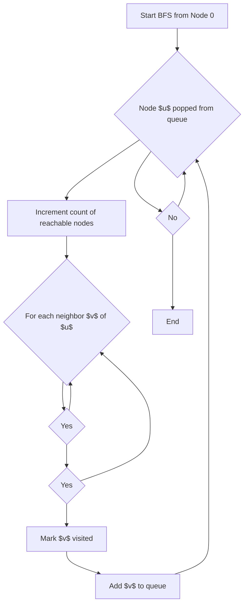
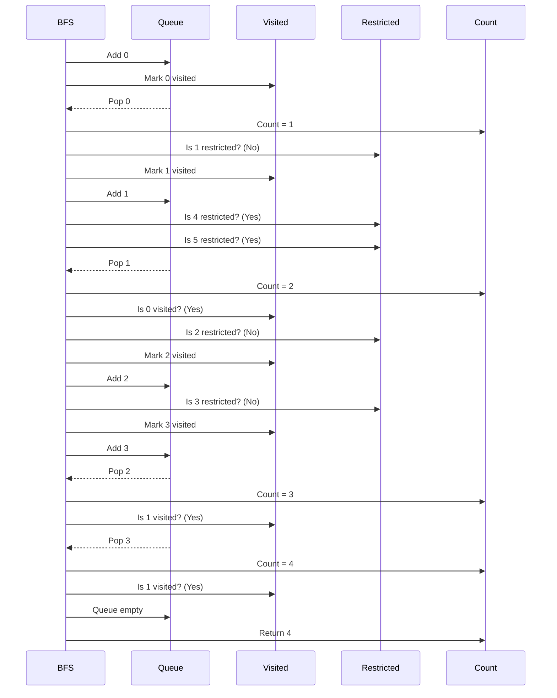

# Reachable Nodes With Restrictions (LeetCode LC-2368)

## 1. Problem Overview
* Platform: LeetCode
* Problem ID: [2368](https://leetcode.com/problems/reachable-nodes-with-restrictions/)
* Rating: Medium
* Tags: algorithms
* Solution File: `solutions/reachableNodesWithRestrictions.js`

Given an undirected graph defined by `n` nodes and a list of `edges`, and a list of `restricted` nodes, the task is to find the number of nodes reachable from node 0, excluding any restricted nodes. Reachability implies traversal through non-restricted nodes.

## 2. Core Intuition & Mathematical Rationale
The core intuition is that this problem is a standard graph traversal problem (BFS or DFS) with an additional constraint: certain nodes cannot be visited. Since we need to find all reachable nodes starting from node 0, Breadth-First Search (BFS) is a natural fit. BFS explores nodes layer by layer, guaranteeing that we find all reachable nodes in the shortest path sense (though path length isn't directly relevant here, it's efficient for finding all connected components).

The approach is optimal because BFS visits each node and edge at most once. For each node $u$ popped from the queue, we iterate through its neighbors $v$. If $v$ has not been visited and is not in the `restricted` set, we mark it visited and add it to the queue. This ensures that only valid, unvisited nodes are counted and explored further. Naive alternatives, such as repeatedly searching or checking reachability for each node, would be inefficient due to redundant computations. DFS would also work but BFS is often preferred for its iterative nature and guarantee of finding all nodes at a given "distance" before moving to the next.



## 3. Visual Step-by-Step Walkthrough
Sample Input 1:
`n = 7`, `edges = [[0, 1], [1, 2], [3, 1], [4, 0], [0, 5], [5, 6]]`, `restricted = [4, 5]`

1. Initialize `restricted` array: `rest = [0, 0, 0, 0, 1, 1, 0]` (nodes 4 and 5 are restricted).
2. Build adjacency list:
   * 0: [1, 4, 5]
   * 1: [0, 2, 3]
   * 2: [1]
   * 3: [1]
   * 4: [0]
   * 5: [0, 6]
   * 6: [5]
3. Initialize `visited` array `vis = [0, 0, 0, 0, 0, 0, 0]`.
4. Initialize `queue = []`, `reachable_count = 0`.
5. Start BFS:
   * Add 0 to queue: `queue = [0]`. Mark `vis[0] = 1`.
   * **Pop 0**: `u = 0`. `reachable_count = 1`.
     * Neighbors of 0: [1, 4, 5]
     * Neighbor 1: Not visited (`vis[1]=0`), Not restricted (`rest[1]=0`). Mark `vis[1]=1`, add to queue. `queue = [1]`.
     * Neighbor 4: Not visited (`vis[4]=0`), Is restricted (`rest[4]=1`). Skip.
     * Neighbor 5: Not visited (`vis[5]=0`), Is restricted (`rest[5]=1`). Skip.
   * **Pop 1**: `u = 1`. `reachable_count = 2`.
     * Neighbors of 1: [0, 2, 3]
     * Neighbor 0: Visited (`vis[0]=1`). Skip.
     * Neighbor 2: Not visited (`vis[2]=0`), Not restricted (`rest[2]=0`). Mark `vis[2]=1`, add to queue. `queue = [2]`.
     * Neighbor 3: Not visited (`vis[3]=0`), Not restricted (`rest[3]=0`). Mark `vis[3]=1`, add to queue. `queue = [2, 3]`.
   * **Pop 2**: `u = 2`. `reachable_count = 3`.
     * Neighbors of 2: [1]
     * Neighbor 1: Visited (`vis[1]=1`). Skip.
   * **Pop 3**: `u = 3`. `reachable_count = 4`.
     * Neighbors of 3: [1]
     * Neighbor 1: Visited (`vis[1]=1`). Skip.
6. Queue is empty. BFS ends.
7. Return `reachable_count = 4`.



## 4. Algorithmic Complexity
* Time per test: $O(N + M)$ where $N$ is the number of nodes and $M$ is the number of edges. Building the adjacency list takes $O(M)$ time. The BFS traversal visits each node and each edge at most once, contributing $O(N + M)$.
* Total time: Sum of $O(N_i + M_i)$ for all test cases.
* Space: $O(N + M)$ for storing the adjacency list (`head`, `to`, `nxt` arrays) and auxiliary data structures like the `restricted` array, `visited` array, and the BFS `queue`. Each of these takes $O(N)$ or $O(M)$ space.
* Recursion depth: $O(1)$ as the BFS is implemented iteratively using a queue.

## 5. Edge Cases & Boundary Conditions
* **Minimum inputs**:
    * `n = 1`, `edges = []`, `restricted = []`: Node 0 is reachable. Returns 1.
    * `n = 1`, `edges = []`, `restricted = [0]`: Node 0 is restricted. Returns 0.
    * `n = 2`, `edges = [[0, 1]]`, `restricted = []`: Nodes 0 and 1 are reachable. Returns 2.
* **Maximum inputs**:
    * `n` can be up to $2 \times 10^5$.
    * `edges.length` can be up to $2 \times 10^5$.
    * `restricted.length` can be up to `n`.
* **Degenerate shapes**:
    * **Disconnected graph**: If node 0 is isolated or only connected to restricted nodes, the BFS will terminate quickly. The algorithm correctly handles this.
    * **Graph where node 0 is restricted**: The problem statement implies node 0 is never restricted, as reachability starts from 0. If 0 *could* be restricted, the current code would start BFS from 0, mark 0 as visited, increment count, and then check `rest[v]` for neighbors. If 0 itself were restricted, it should not be counted. The given solution explicitly checks `!rest[v]` for *neighbors* `v`, but implicitly counts 0 as reachable if it's not restricted. The problem implies "reachable nodes *from* node 0", and node 0 itself is considered reachable.
    * **All nodes restricted (except 0)**: Only node 0 would be counted.
    * **No nodes restricted**: Standard BFS for connected component of 0.
* **Accumulator maximums**:
    * `ans` (reachable count): Up to `n`, which is $2 \times 10^5$. Fits comfortably within standard integer types (e.g., `Number` in JS, which uses 64-bit floats and can safely represent integers up to $2^{53}-1$).
    * `edgeCount`: Up to `edges.length * 2`, so $4 \times 10^5$. Fits.
    * Array indices: Up to `n` or `edges.length * 2`, well within $2^{53}-1$.
    * `Uint8Array` for `rest` and `vis`: Each element is 0 or 1, values fit. Array length up to $2 \times 10^5$.
    * `Int32Array` for `head`, `to`, `nxt`, `queue`: Elements are node indices or edge indices, fitting into 32-bit integers. Array length up to $2 \times 10^5$ or $4 \times 10^5$.

## 6. Reference Implementation
```javascript
var reachableNodes = function(n, edges, restricted) {
  const rest = new Uint8Array(n);
  for (let i = 0; i < restricted.length; i++) {
    rest[restricted[i]] = 1;
  }

  // Adjacency list using array-based representation (similar to C-style linked list)
  const head = new Int32Array(n).fill(-1); // head[u] stores the index of the first edge from u
  const to = new Int32Array(edges.length * 2); // Stores the destination node of an edge
  const nxt = new Int32Array(edges.length * 2); // Stores the index of the next edge from the same source node
  let edgeCount = 0;

  function addEdge(u, v) {
    to[edgeCount] = v;
    nxt[edgeCount] = head[u];
    head[u] = edgeCount++;
  }

  for (let i = 0; i < edges.length; i++) {
    const u = edges[i][0];
    const v = edges[i][1];
    addEdge(u, v);
    addEdge(v, u); // Graph is undirected
  }

  const vis = new Uint8Array(n); // Visited array for BFS
  const queue = new Int32Array(n); // BFS queue
  let qh = 0, qt = 0; // qh: queue head, qt: queue tail

  queue[qt++] = 0; // Start BFS from node 0
  vis[0] = 1;
  let ans = 0;

  while (qh < qt) {
    const u = queue[qh++];
    ans++; // Count the current node as reachable

    // Iterate through neighbors of u
    for (let e = head[u]; e !== -1; e = nxt[e]) {
      const v = to[e];
      // If neighbor v has not been visited and is not restricted
      if (!vis[v] && !rest[v]) {
        vis[v] = 1; // Mark as visited
        queue[qt++] = v; // Add to queue
      }
    }
  }

  return ans;
};

var solve = reachableNodes;

if (require.main === module) {
  const fs = require('fs');
  try {
    const raw = fs.readFileSync(0, 'utf-8').trim();
    if (raw) {
      const parsed = JSON.parse(raw);
      console.log(JSON.stringify(solve(parsed[0], parsed[1], parsed[2])));
    }
  } catch (e) {}
}

module.exports = reachableNodes;
```