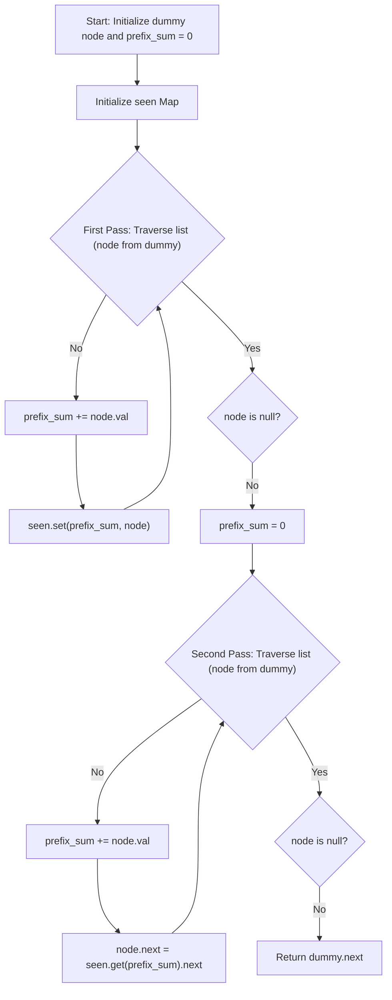

# Remove Zero Sum Consecutive Nodes from Linked List (LeetCode LC-1171)

## 1. Problem Overview
* Platform: LeetCode
* Problem ID: [1171](https://leetcode.com/problems/remove-zero-sum-consecutive-nodes-from-linked-list/)
* Rating: Medium
* Tags: algorithms
* Solution File: `solutions/removeZeroSumConsecutiveNodesFromLinkedList.js`

Given the head of a singly linked list, the task is to remove all consecutive sequences of nodes that sum to zero. The resulting linked list should not contain any such sublists.

## 2. Core Intuition & Mathematical Rationale

The core intuition relies on prefix sums. If the prefix sum at node $A$ is $P_A$ and the prefix sum at node $B$ (where $B$ appears after $A$) is also $P_B = P_A$, then the sum of nodes between $A$ and $B$ (exclusive of $A$, inclusive of $B$) must be zero. That is, $\sum_{i=A.next}^{B} node_i.val = P_B - P_A = 0$. This implies that the sublist from $A.next$ to $B$ should be removed.

The optimal approach uses a hash map (or `Map` in JavaScript) to store the latest node encountered for each prefix sum.
1. In the first pass, we iterate through the linked list, calculate the prefix sum, and store `(prefix_sum, latest_node)` in the map. If a prefix sum is encountered again, we update its corresponding node to the *latest* node seen. This ensures that if multiple sublists sum to zero, we remove the longest possible one ending at the current node.
2. In the second pass, we again calculate prefix sums. For each node, we find the "target" node in our map associated with its current prefix sum. If `current_node.next` should be removed because its sublist sums to zero, we effectively bypass it by setting `current_node.next = map.get(current_prefix_sum).next`. This effectively links the current node directly to the node *after* the zero-sum sublist.

Naive alternatives, like repeatedly searching for zero-sum sublists and deleting them, would be inefficient due to multiple traversals and node re-linking, potentially leading to $O(N^2)$ time complexity for an $N$-length list. The two-pass prefix sum approach guarantees $O(N)$ time complexity as each node is visited a constant number of times.



## 3. Visual Step-by-Step Walkthrough

Sample Input: `[1, 2, -3, 3, 1]`
Expected Output: `[3, 1]`

Let's use `head = [1, 2, -3, 3, 1]`
Nodes: `D -> 1 -> 2 -> -3 -> 3 -> 1 -> null` (where D is the dummy node)

**First Pass: Populate `seen` map**

| Current Node | `node.val` | `prefix` | `seen` (after `seen.set(prefix, node)`) |
|---|---|---|---|
| `D` | 0 | 0 | `{0: D}` |
| `1` | 1 | 1 | `{0: D, 1: 1}` |
| `2` | 2 | 3 | `{0: D, 1: 1, 3: 2}` |
| `-3` | -3 | 0 | `{0: -3, 1: 1, 3: 2}` (D is overwritten by -3 for prefix 0) |
| `3` | 3 | 3 | `{0: -3, 1: 1, 3: 3}` (2 is overwritten by 3 for prefix 3) |
| `1` | 1 | 4 | `{0: -3, 1: 1, 3: 3, 4: 1}` |
| `null` | - | - | - |

Final `seen` map: `{0: node(-3), 1: node(1), 3: node(3), 4: node(1_final)}`

**Second Pass: Adjust `next` pointers**

| Current Node | `node.val` | `prefix` | `seen.get(prefix)` | `node.next` becomes |
|---|---|---|---|---|
| `D` | 0 | 0 | `node(-3)` | `node(-3).next` (which is `node(3)`) |
| `3` | 3 | 3 | `node(3)` | `node(3).next` (which is `node(1_final)`) |
| `1_final` | 1 | 4 | `node(1_final)` | `node(1_final).next` (which is `null`) |
| `null` | - | - | - | - |

Resulting List: `D -> 3 -> 1 -> null`.
`dummy.next` points to `3`. Output: `[3, 1]`.

```mermaid
sequenceDiagram
    participant D as Dummy Node
    participant N1 as Node(1)
    participant N2 as Node(2)
    participant N_3 as Node(-3)
    participant N3 as Node(3)
    participant N1_final as Node(1_final)

    D->N1: original next
    N1->N2: original next
    N2->N_3: original next
    N_3->N3: original next
    N3->N1_final: original next
    N1_final->>null: original next

    rect rgb(200, 255, 200)
        box First Pass: Populate seen map
        D->>D: prefix=0, seen[0]=D
        N1->>N1: prefix=1, seen[1]=N1
        N2->>N2: prefix=3, seen[3]=N2
        N_3->>N_3: prefix=0, seen[0]=N_3 (overwrites D)
        N3->>N3: prefix=3, seen[3]=N3 (overwrites N2)
        N1_final->>N1_final: prefix=4, seen[4]=N1_final
    end

    rect rgb(255, 200, 200)
        box Second Pass: Adjust next pointers
        D->>N_3: prefix=0, D.next = seen[0].next (N3)
        N3->>N1_final: prefix=3, N3.next = seen[3].next (N1_final)
        N1_final->>null: prefix=4, N1_final.next = seen[4].next (null)
    end
    Note right of D: Final list: D -> N3 -> N1_final
    D-->>N3: dummy.next points to N3
```

## 4. Algorithmic Complexity

*   **Time per test**: $O(N)$, where $N$ is the number of nodes in the linked list. This is because there are two passes over the list. Each pass iterates through $N$ nodes, performing constant-time operations (addition, map lookup/insertion).
*   **Total time**: $O(N)$ for a single test case. If multiple test cases are run, it's $O(\sum N_i)$ where $N_i$ is the number of nodes in list $i$.
*   **Space**: $O(N)$ due to the `seen` map. In the worst case (e.g., all positive numbers), the map could store an entry for every unique prefix sum, which could be up to $N$ entries.
*   **Recursion depth**: $O(1)$, as the solution is iterative and does not use recursion.

## 5. Edge Cases & Boundary Conditions

*   **Empty List**: If `head` is `null`, `dummy.next` is `null`, and the function correctly returns `null`. The `for` loops won't execute.
*   **List with a single node**:
    *   `[5]`: `prefix` goes `0 -> 5`. `seen = {0:D, 5:N5}`. Second pass: `D.next = seen.get(0).next` (which is `N5`). `N5.next = seen.get(5).next` (which is `null`). Result: `[5]`. Correct.
    *   `[0]`: `prefix` goes `0 -> 0`. `seen = {0:N0}`. Second pass: `D.next = seen.get(0).next` (which is `null`). Result: `[]`. Correct, as `[0]` sums to zero.
*   **Entire list sums to zero**: E.g., `[1, 2, -3]`.
    *   `prefix` values: `0 (D) -> 1 (1) -> 3 (2) -> 0 (-3)`.
    *   `seen` map: `{0: -3, 1: 1, 3: 2}`.
    *   Second pass: `D.next` (prefix 0) will point to `seen.get(0).next` (which is `-3.next`, i.e., `null`). The result will be an empty list. Correct.
*   **All nodes sum to zero consecutively**: E.g., `[1, -1, 2, -2]`.
    *   `prefix` values: `0(D) -> 1(1) -> 0(-1) -> 2(2) -> 0(-2)`.
    *   `seen` map: `{0: -2, 1: 1, 2: 2}`.
    *   Second pass: `D.next` (prefix 0) will point to `seen.get(0).next` (which is `-2.next`, i.e., `null`). The result will be an empty list. Correct.
*   **Maximum accumulator value**: Node values are `[-1000, 1000]`. Number of nodes `[1, 1000]`.
    *   The maximum possible prefix sum is $1000 \times 1000 = 1,000,000$.
    *   The minimum possible prefix sum is $1000 \times (-1000) = -1,000,000$.
    *   Both these values are well within the safe integer range for JavaScript numbers (up to $2^{53} - 1 \approx 9 \times 10^{15}$).

## 6. Reference Implementation

```javascript
function ListNode(val, next) {
  this.val = (val === undefined ? 0 : val);
  this.next = (next === undefined ? null : next);
}

var removeZeroSumSublists = function(head) {
  const dummy = new ListNode(0, head);
  let prefix = 0;
  const seen = new Map();

  for (let node = dummy; node !== null; node = node.next) {
    prefix += node.val;
    seen.set(prefix, node);
  }

  prefix = 0;
  for (let node = dummy; node !== null; node = node.next) {
    prefix += node.val;
    node.next = seen.get(prefix).next;
  }

  return dummy.next;
};

var solve = function(arr) {
  if (!arr || arr.length === 0) return [];
  const dummy = new ListNode(0);
  let cur = dummy;
  for (let i = 0; i < arr.length; i++) {
    cur.next = new ListNode(arr[i]);
    cur = cur.next;
  }
  let res = removeZeroSumSublists(dummy.next);
  const out = [];
  while (res !== null) {
    out.push(res.val);
    res = res.next;
  }
  return out;
};

if (require.main === module) {
  const fs = require('fs');
  try {
    const raw = fs.readFileSync(0, 'utf-8').trim();
    if (raw) {
      const parsed = JSON.parse(raw);
      console.log(JSON.stringify(solve(parsed)));
    }
  } catch (e) {}
}

module.exports = removeZeroSumSublists;
```