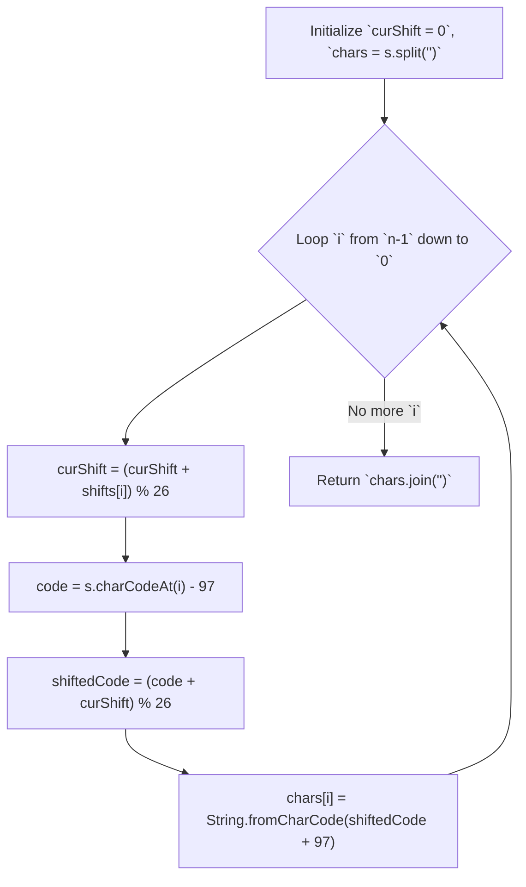
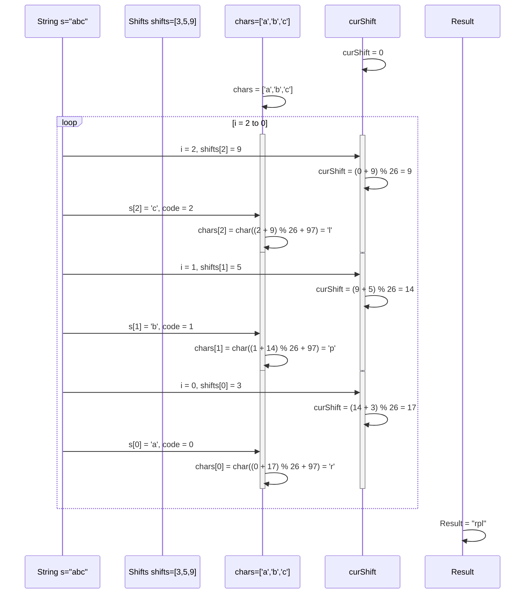

# Shifting Letters (LeetCode LC-848)

## 1. Problem Overview
* Platform: LeetCode
* Problem ID: [848 - Shifting Letters](https://leetcode.com/problems/shifting-letters/)
* Rating: Medium
* Tags: algorithms
* Solution File: `solutions/shiftingLetters.js`

Given a string `s` and an integer array `shifts` of the same length, we need to apply a series of shifts to `s`. For each `shifts[i]`, we shift the first `i + 1` letters of `s` by `shifts[i]` positions.

## 2. Core Intuition & Mathematical Rationale
The key observation is that shifts are cumulative from right to left. When we apply `shifts[i]`, it affects `s[0]` through `s[i]`. This means `s[i]` is affected by `shifts[i]`, `s[i-1]` is affected by `shifts[i-1]` and `shifts[i]`, and so on. A naive approach of iterating `i` from $0$ to $n-1$ and then applying `shifts[i]` to `s[0...i]` would lead to $O(N^2)$ complexity, which is inefficient for large $N$.

The optimal approach is to iterate from right to left ($i$ from $n-1$ down to $0$). For each character `s[i]`, its total shift will be the sum of `shifts[i]` and all subsequent shifts `shifts[i+1], shifts[i+2], ..., shifts[n-1]`. We can maintain a running `curShift` variable that accumulates the shifts as we move left.
When processing `s[i]`:
1. Update `curShift = (curShift + shifts[i]) % 26`. The modulo $26$ ensures the shift amount remains within the alphabet size.
2. Calculate the character's new position: `new_code = (original_code + curShift) % 26`.
3. Convert `new_code` back to a character.

This approach is optimal because each character's final shift is determined by its own `shifts[i]` and the total shift accumulated from characters to its right. By calculating this sum once for each character, we achieve $O(N)$ complexity.



## 3. Visual Step-by-Step Walkthrough
Sample Input: `s = "abc"`, `shifts = [3, 5, 9]`

* `n = 3`
* `chars = ['a', 'b', 'c']`
* `curShift = 0`

**Iteration `i = 2` (character 'c'):**
* `shifts[2] = 9`
* `curShift = (0 + 9) % 26 = 9`
* `s.charCodeAt(2) - 97 = 'c'.charCodeAt(0) - 97 = 99 - 97 = 2`
* `shiftedCode = (2 + 9) % 26 = 11 % 26 = 11`
* `chars[2] = String.fromCharCode(11 + 97) = String.fromCharCode(108) = 'l'`
* `chars` is now `['a', 'b', 'l']`

**Iteration `i = 1` (character 'b'):**
* `shifts[1] = 5`
* `curShift = (9 + 5) % 26 = 14 % 26 = 14`
* `s.charCodeAt(1) - 97 = 'b'.charCodeAt(0) - 97 = 98 - 97 = 1`
* `shiftedCode = (1 + 14) % 26 = 15 % 26 = 15`
* `chars[1] = String.fromCharCode(15 + 97) = String.fromCharCode(112) = 'p'`
* `chars` is now `['a', 'p', 'l']`

**Iteration `i = 0` (character 'a'):**
* `shifts[0] = 3`
* `curShift = (14 + 3) % 26 = 17 % 26 = 17`
* `s.charCodeAt(0) - 97 = 'a'.charCodeAt(0) - 97 = 97 - 97 = 0`
* `shiftedCode = (0 + 17) % 26 = 17 % 26 = 17`
* `chars[0] = String.fromCharCode(17 + 97) = String.fromCharCode(114) = 'r'`
* `chars` is now `['r', 'p', 'l']`

**End Loop.**

**Result:** `chars.join('') = "rpl"`



## 4. Algorithmic Complexity
* Time per test: $O(N)$, where $N$ is the length of the string `s` and `shifts` array. This is due to a single pass through the array from right to left.
* Total time: $O(T \cdot N)$, where $T$ is the number of test cases.
* Space: $O(N)$ for storing the `chars` array (the string `s` converted to a mutable array of characters). If modifying the string in-place is considered $O(1)$ auxiliary space, then it would be $O(1)$.
* Recursion depth: $O(1)$, as the solution is iterative.

## 5. Edge Cases & Boundary Conditions
* **Minimum input string length:** $s$ can have length $1$. Example: `s = "a"`, `shifts = [25]`. Result: "z". The loop runs once, `curShift` becomes $25$, 'a' shifts to 'z'.
* **Maximum input string length:** Based on typical LeetCode constraints, $N$ could be up to $10^5$.
* **`shifts` values:** `shifts[i]` can range from $0$ to $10^9$. The modulo $26$ operation handles large shift values correctly, preventing overflow issues and keeping the effective shift within $0-25$.
* **All shifts are zero:** `s = "abc"`, `shifts = [0, 0, 0]`. Result: "abc". `curShift` remains $0$ throughout, no characters change.
* **All shifts are very large multiples of 26:** `s = "abc"`, `shifts = [2600, 5200, 7800]`. Result: "abc". `curShift % 26` will always be $0$.
* **Maximum accumulator value:** `curShift` can accumulate up to $N \times \max(shifts[i])$. If $N = 10^5$ and $\max(shifts[i]) = 10^9$, then `curShift` could be up to $10^{14}$. This value fits comfortably within standard 64-bit integer types (and JavaScript's `Number` type, which is a 64-bit float, representing integers up to $2^{53}-1$ precisely). The intermediate sum `curShift + shifts[i]` before modulo can also be $10^{14} + 10^9 \approx 10^{14}$, well within `2^53 - 1`.

## 6. Reference Implementation
```javascript
var shiftingLetters = function(s, shifts) {
  const n = s.length;
  const chars = s.split('');
  let curShift = 0;

  for (let i = n - 1; i >= 0; i--) {
    // Accumulate current shift and apply modulo to keep it within 0-25
    curShift = (curShift + shifts[i]) % 26;
    
    // Get character's 0-indexed position (a=0, b=1, ...)
    const code = s.charCodeAt(i) - 97;
    
    // Calculate new character's 0-indexed position after shifting
    const shiftedCode = (code + curShift) % 26;
    
    // Convert back to character and update in-place
    chars[i] = String.fromCharCode(shiftedCode + 97);
  }

  return chars.join('');
};

var solve = shiftingLetters;

if (require.main === module) {
  const fs = require('fs');
  try {
    const raw = fs.readFileSync(0, 'utf-8').trim();
    if (raw) {
      const parsed = JSON.parse(raw);
      console.log(JSON.stringify(solve(parsed[0], parsed[1])));
    }
  } catch (e) {}
}

module.exports = shiftingLetters;
```