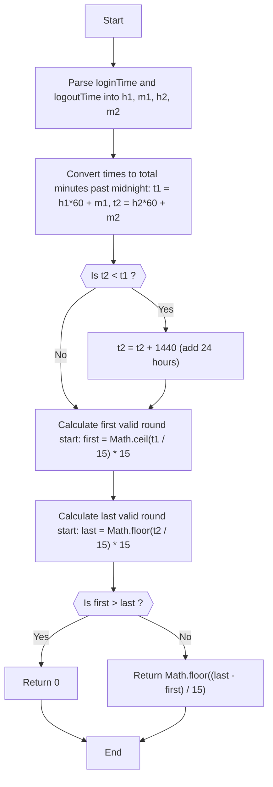
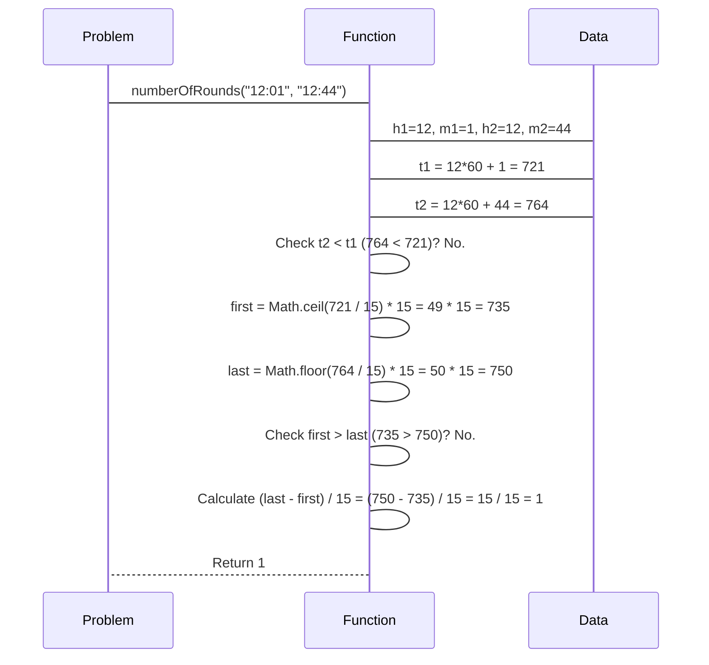

# The Number of Full Rounds You Have Played (LeetCode LC-1904)

## 1. Problem Overview
* Platform: LeetCode
* Problem ID: [1904 The Number of Full Rounds You Have Played](https://leetcode.com/problems/the-number-of-full-rounds-you-have-played/)
* Rating: Medium
* Tags: algorithms
* Solution File: `solutions/theNumberOfFullRoundsYouHavePlayed.js`
The problem asks to calculate the number of full 15-minute rounds played between a given login time and logout time. A round starts at a multiple of 15 minutes (e.g., 12:00, 12:15, 12:30, 12:45) and ends 15 minutes later.

## 2. Core Intuition & Mathematical Rationale
The core idea is to convert both login and logout times into minutes past midnight, making time comparisons and calculations straightforward. Full rounds can only begin at times that are exact multiples of 15 minutes (e.g., $HH:00, HH:15, HH:30, HH:45$). Therefore, we need to find the first valid round start time after or at the login time, and the last valid round start time before or at the logout time.

To find the first valid round start time ($first$), we take the login time in minutes ($t1$) and use `Math.ceil(t1 / 15) * 15`. This rounds $t1$ up to the nearest multiple of 15. For example, if $t1 = 12:01 \Rightarrow 721$ minutes, `Math.ceil(721 / 15) * 15 = Math.ceil(48.066...) * 15 = 49 * 15 = 735$ minutes, which is $12:15$.

To find the last valid round start time ($last$), we take the logout time in minutes ($t2$) and use `Math.floor(t2 / 15) * 15`. This rounds $t2$ down to the nearest multiple of 15. For example, if $t2 = 12:44 \Rightarrow 764$ minutes, `Math.floor(764 / 15) * 15 = Math.floor(50.933...) * 15 = 50 * 15 = 750$ minutes, which is $12:30$.

A critical edge case is when the logout time is chronologically *earlier* than the login time, indicating that play spanned across midnight. In this scenario, we add 24 hours (1440 minutes) to $t2$ to correctly represent the time duration. For example, login "20:00", logout "06:00" means $t2$ becomes $360 + 1440 = 1800$ minutes.

After calculating $first$ and $last$, if $first > last$, it means no full round could be completed (e.g., login at 12:01, logout at 12:14, first valid start is 12:15, which is after 12:14). In this case, the result is 0. Otherwise, the number of full rounds is $\lfloor (last - first) / 15 \rfloor$.

This approach is optimal because it directly calculates the valid start and end points in terms of 15-minute intervals and then performs a simple division to count the intervals. Naive alternatives involving iterating minute by minute would be computationally more expensive and unnecessary.



## 3. Visual Step-by-Step Walkthrough

Let's trace Sample 1: `loginTime = "12:01"`, `logoutTime = "12:44"`

1. **Parse times**:
   `h1 = 12`, `m1 = 1`
   `h2 = 12`, `m2 = 44`

2. **Convert to total minutes**:
   `t1 = 12 * 60 + 1 = 721` minutes
   `t2 = 12 * 60 + 44 = 764` minutes

3. **Check for midnight crossing**:
   Is `t2 < t1`? Is `764 < 721`? No.

4. **Calculate `first`**:
   `first = Math.ceil(t1 / 15) * 15`
   `first = Math.ceil(721 / 15) * 15`
   `first = Math.ceil(48.066...) * 15`
   `first = 49 * 15 = 735` minutes (which is 12:15)

5. **Calculate `last`**:
   `last = Math.floor(t2 / 15) * 15`
   `last = Math.floor(764 / 15) * 15`
   `last = Math.floor(50.933...) * 15`
   `last = 50 * 15 = 750` minutes (which is 12:30)

6. **Check `first > last`**:
   Is `735 > 750`? No.

7. **Calculate result**:
   `Math.floor((last - first) / 15)`
   `Math.floor((750 - 735) / 15)`
   `Math.floor(15 / 15)`
   `Math.floor(1) = 1`

Final result: 1.



## 4. Algorithmic Complexity

*   **Time Complexity per test case**: $O(1)$
    The operations involve parsing two strings, a few arithmetic calculations (multiplication, addition, division, ceiling, floor), and a comparison. All these operations take constant time.
*   **Total Time Complexity**: $O(N)$
    Where $N$ is the number of test cases. Each test case is processed independently in $O(1)$ time.
*   **Space Complexity**: $O(1)$
    A constant number of variables are used to store hours, minutes, and total minutes. The memory usage does not scale with the input values.
*   **Recursion Depth**: $O(1)$
    The function is iterative and does not involve recursion.

## 5. Edge Cases & Boundary Conditions

*   **Minimum/Maximum inputs**:
    *   Time representations are "HH:MM".
    *   Minimum `loginTime` is "00:00", minimum `logoutTime` is "00:00".
    *   Maximum `loginTime` is "23:59", maximum `logoutTime` is "23:59".
*   **Degenerate shapes**:
    *   `loginTime` and `logoutTime` are identical (e.g., "12:00", "12:00"): `t1=t2`. `first` will be `Math.ceil(t1/15)*15`, `last` will be `Math.floor(t2/15)*15`. If $t1$ is a multiple of 15, `first=last=t1`, and `(last-first)/15=0`. If $t1$ is not a multiple of 15, `first` will be greater than `last`, resulting in 0. This is correct as no full round can be played.
    *   `logoutTime` is just before `loginTime` (e.g., "12:01", "12:00"): This will trigger `t2 < t1` and `t2` will be adjusted to `t2 + 1440`. The logic handles this correctly by extending the duration over midnight.
    *   Short duration where no full round is possible (e.g., "12:01", "12:14"): `t1=721`, `t2=734`. `first = Math.ceil(721/15)*15 = 735` (12:15). `last = Math.floor(734/15)*15 = 720` (12:00). Here, `first > last` (`735 > 720`), so it correctly returns 0.
    *   Longest possible duration (e.g., "00:00", "23:59"):
        *   `t1 = 0`, `t2 = 23*60 + 59 = 1439`.
        *   `t2 < t1` is false.
        *   `first = Math.ceil(0 / 15) * 15 = 0`.
        *   `last = Math.floor(1439 / 15) * 15 = Math.floor(95.93...) * 15 = 95 * 15 = 1425`.
        *   `first > last` is false.
        *   `Math.floor((1425 - 0) / 15) = Math.floor(1425 / 15) = 95`. This correctly yields 95 full rounds.
*   **Maximum accumulator values**:
    *   `h1, m1, h2, m2` are small integers, maximum `23` and `59` respectively.
    *   `t1, t2` (minutes past midnight) will be at most `23*60 + 59 = 1439`.
    *   When `t2` is adjusted for midnight crossing, its maximum value becomes `1439 + 1440 = 2879`.
    *   `first` and `last` will also be in a similar range, at most `2880` (multiple of 15 near 2879).
    *   `last - first` will be at most `2879 - 0 = 2879`.
    *   `Math.floor((last - first) / 15)` will be at most `Math.floor(2879 / 15) = 191`.
    *   All these values are well within the safe integer range for JavaScript numbers (2^53 - 1).

## 6. Reference Implementation

```javascript
var numberOfRounds = function(loginTime, logoutTime) {
  const t1Arr = loginTime.split(':');
  const t2Arr = logoutTime.split(':');
  const h1 = Number(t1Arr[0]);
  const m1 = Number(t1Arr[1]);
  const h2 = Number(t2Arr[0]);
  const m2 = Number(t2Arr[1]);

  let t1 = h1 * 60 + m1;
  let t2 = h2 * 60 + m2;
  if (t2 < t1) t2 += 1440; // Add 24 hours (1440 minutes) if logout is on the next day

  // Calculate the first valid 15-minute interval start after or at loginTime
  const first = Math.ceil(t1 / 15) * 15;
  // Calculate the last valid 15-minute interval start before or at logoutTime
  const last = Math.floor(t2 / 15) * 15;

  // If the first possible round start is after the last possible round start, no full rounds
  if (first > last) return 0;
  
  // Calculate the number of full 15-minute rounds
  return Math.floor((last - first) / 15);
};

var solve = numberOfRounds;

if (require.main === module) {
  const fs = require('fs');
  try {
    const raw = fs.readFileSync(0, 'utf-8').trim();
    if (raw) {
      const parsed = JSON.parse(raw);
      console.log(JSON.stringify(solve(parsed[0], parsed[1])));
    }
  } catch (e) {}
}

module.exports = numberOfRounds;
```