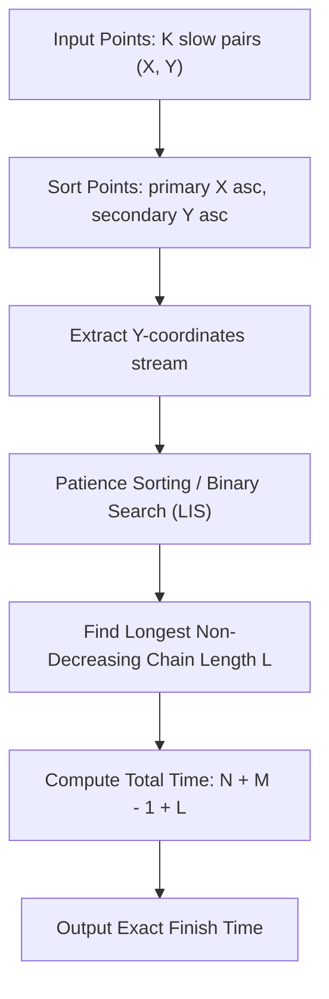
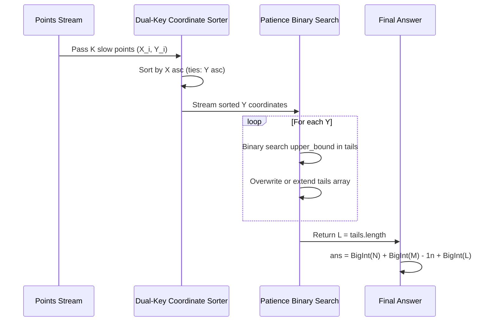

# Car Wash (CodeChef CC-CARWASH)

## 1. Problem Overview
- **Platform:** CodeChef
- **Problem ID:** [CC-CARWASH](https://www.codechef.com/problems/CARWASH)
- **Difficulty / Rating:** 1513
- **Tags:** dynamic programming, greedy, longest increasing subsequence, binary search, coordinate compression
- **Solution File:** `carWash.js`
- **Starter Template:** `templates/codechef.js`

---

## 2. Core Intuition & Mathematical Rationale

### Mathematical Equivalence to 2D Longest Path
Let $S(i, j)$ denote the start time of car $i$ at station $j$, and $E(i, j)$ denote its completion time.
Because each car must wait for the preceding car at the same station and cannot enter station $j$ until it finishes station $j-1$, we have:
$$E(i, j) = \max(E(i-1, j), E(i, j-1)) + \text{cost}(i, j)$$
with boundary conditions $E(0, j) = 0$ and $E(i, 0) = 0$.

In a standard grid without delays, $\text{cost}(i, j) = 1$. The length of every path from $(1, 1)$ to $(N, M)$ stepping only $(+1, 0)$ or $(0, +1)$ consists of exactly:
$$(N - 1) + (M - 1) + 1 = N + M - 1 \text{ vertices}$$
giving a uniform base completion time of $N + M - 1$.

### Delays as Point Weights
Each given slow pair $(X_r, Y_r)$ takes $2$ minutes instead of $1$, effectively adding $+1$ additional minute to that specific grid cell:
$$\text{cost}(X_r, Y_r) = 2 = 1 + 1$$
Therefore, any path traversing a subset $P$ of slow vertices achieves total length:
$$E(N, M) = (N + M - 1) + |P|$$
A path can visit a sequence of slow points $p_1, p_2, \dots, p_L$ if and only if they form a non-decreasing chain in 2D:
$$X_1 \le X_2 \le \dots \le X_L \quad \text{and} \quad Y_1 \le Y_2 \le \dots \le Y_L$$

Thus, maximizing the path length is strictly equivalent to finding the **Longest Non-Decreasing Subsequence in 2D** over the $K$ slow pairs!



---

## 3. Visual Step-by-Step Walkthrough



---

## 4. Algorithmic Complexity

| Dimension | Bound | Proof & Rationale |
|---|:---:|---|
| **Time Complexity** | $O(K \log K)$ | Sorting $K$ coordinates takes $O(K \log K)$; patience binary search takes $O(K \log K)$. Total $\sum K \le 2 \cdot 10^5$. |
| **Space Complexity** | $O(K)$ | Storing point coordinates and the binary search `tails` buffer of size $\le K$. |
| **Numeric Safety** | `BigInt` | $N, M \le 10^9 \implies N + M \le 2 \cdot 10^9$. Fits within 64-bit BigInt / plain safe numbers. |

---

## 5. Idiomatic Implementation
```javascript
// Reference: solutions/carWash.js
```
